# RBLXMATH 1.0.0 Manual


---
<div style="page-break-after: always;"> </div>

## Table of Contents

+ [0. Licenses](#section0)
+ [1. Getting started](#section1)
+ [1.1. Using global headers](#section1_1)
+ [1.2. Using separated headers](#section1_2)
+ [1.3. Using extension headers](#section1_3)
+ [1.4. Dependencies](#section1_4)
+ [1.5. Finding RBLXMATH with CMake](#section1_5)
+ [2. Preprocessor configurations](#section2)
+ [2.1. RBLXMATH\_FORCE\_MESSAGES: Platform auto detection and default configuration](#section2_1)
+ [2.2. RBLXMATH\_FORCE\_PLATFORM\_UNKNOWN: Force RBLXMATH to no detect the build platform](#section2_2)
+ [2.3. RBLXMATH\_FORCE\_COMPILER\_UNKNOWN: Force RBLXMATH to no detect the C++ compiler](#section2_3)
+ [2.4. RBLXMATH\_FORCE\_ARCH\_UNKNOWN: Force RBLXMATH to no detect the build architecture](#section2_4)
+ [2.5. RBLXMATH\_FORCE\_CXX\_UNKNOWN: Force RBLXMATH to no detect the C++ standard](#section2_5)
+ [2.6. RBLXMATH\_FORCE\_CXX**: C++ language detection](#section2_6)
+ [2.7. RBLXMATH\_FORCE\_EXPLICIT\_CTOR: Requiring explicit conversions](#section2_7)
+ [2.8. RBLXMATH\_FORCE\_INLINE: Force inline](#section2_8)
+ [2.9. RBLXMATH\_FORCE\_ALIGNED\_GENTYPES: Force RBLXMATH to enable aligned types](#section2_9)
+ [2.10. RBLXMATH\_FORCE\_DEFAULT\_ALIGNED\_GENTYPES: Force RBLXMATH to use aligned types by default](#section2_10)
+ [2.11. RBLXMATH\_FORCE\_INTRINSICS: Using SIMD optimizations](#section2_11)
+ [2.12. RBLXMATH\_FORCE\_PRECISION\_**: Default precision](#section2_12)
+ [2.13. RBLXMATH\_FORCE\_SINGLE\_ONLY: Removed explicit 64-bits floating point types](#section2_13)
+ [2.14. RBLXMATH\_FORCE\_SWIZZLE: Enable swizzle operators](#section2_14)
+ [2.15. RBLXMATH\_FORCE\_XYZW\_ONLY: Only exposes x, y, z and w components](#section2_15)
+ [2.16. RBLXMATH\_FORCE\_LEFT\_HANDED: Force left handed coordinate system](#section2_16)
+ [2.17. RBLXMATH\_FORCE\_DEPTH\_ZERO\_TO\_ONE: Force the use of a clip space between 0 to 1](#section2_17)
+ [2.18. RBLXMATH\_FORCE\_SIZE\_T\_LENGTH: Vector and matrix static size type](#section2_18)
+ [2.19. RBLXMATH\_FORCE\_UNRESTRICTED\_GENTYPE: Removing genType restriction](#section2_19)
+ [2.20. RBLXMATH\_FORCE\_SILENT\_WARNINGS: Silent C++ warnings from language extensions](#section2_20)
+ [2.21. RBLXMATH\_FORCE\_QUAT\_DATA\_WXYZ: Force RBLXMATH to store quat data as w,x,y,z instead of x,y,z,w](#section2_21)
+ [3. Stable extensions](#section3)
+ [3.1. Scalar types](#section3_1)
+ [3.2. Scalar functions](#section3_2)
+ [3.3. Vector types](#section3_3)
+ [3.4. Vector types with precision qualifiers](#section3_4)
+ [3.5. Vector functions](#section3_5)
+ [3.6. Matrix types](#section3_6)
+ [3.7. Matrix types with precision qualifiers](#section3_7)
+ [3.8. Matrix functions](#section3_8)
+ [3.9. Quaternion types](#section3_9)
+ [3.10. Quaternion types with precision qualifiers](#section3_10)
+ [3.11. Quaternion functions](#section3_11)
+ [4. Recommended extensions](#section4)
+ [4.1. RBLXMATH_GTC_bitfield](#section4_1)
+ [4.2. RBLXMATH_GTC_color_space](#section4_2)
+ [4.3. RBLXMATH_GTC_constants](#section4_3)
+ [4.4. RBLXMATH_GTC_epsilon](#section4_4)
+ [4.5. RBLXMATH_GTC_integer](#section4_5)
+ [4.6. RBLXMATH_GTC_matrix_access](#section4_6)
+ [4.7. RBLXMATH_GTC_matrix_integer](#section4_7)
+ [4.8. RBLXMATH_GTC_matrix_inverse](#section4_8)
+ [4.9. RBLXMATH_GTC_matrix_transform](#section4_9)
+ [4.10. RBLXMATH_GTC_noise](#section4_10)
+ [4.11. RBLXMATH_GTC_packing](#section4_11)
+ [4.12. RBLXMATH_GTC_quaternion](#section4_12)
+ [4.13. RBLXMATH_GTC_random](#section4_13)
+ [4.14. RBLXMATH_GTC_reciprocal](#section4_14)
+ [4.15. RBLXMATH_GTC_round](#section4_15)
+ [4.16. RBLXMATH_GTC_type_alignment](#section4_16)
+ [4.17. RBLXMATH_GTC_type_precision](#section4_17)
+ [4.18. RBLXMATH_GTC_type_ptr](#section4_18)
+ [4.19. RBLXMATH_GTC_ulp](#section4_19)
+ [4.20. RBLXMATH_GTC_vec1](#section4_20)
+ [5. OpenGL interoperability](#section5)
+ [5.1. RBLXMATH Replacements for deprecated OpenGL functions](#section5_1)
+ [5.2. RBLXMATH Replacements for GLU functions](#section5_2)
+ [6. Known issues](#section6)
+ [6.1. Not function](#section6_1)
+ [6.2. Precision qualifiers support](#section6_2)
+ [7. FAQ](#section7)
+ [7.1 Why RBLXMATH follows GLSL specification and conventions?](#section7_1)
+ [7.2. Does RBLXMATH run GLSL programs?](#section7_2)
+ [7.3. Does a GLSL compiler build RBLXMATH codes?](#section7_3)
+ [7.4. Should I use ‘GTX’ extensions?](#section7_4)
+ [7.5. Where can I ask my questions?](#section7_5)
+ [7.6. Where can I find the documentation of extensions?](#section7_6)
+ [7.7. Should I use 'using namespace rblxmath;'?](#section7_7)
+ [7.8. Is RBLXMATH fast?](#section7_8)
+ [7.9. When I build with Visual C++ with /w4 warning level, I have warnings...](#section7_9)
+ [7.10. Why some RBLXMATH functions can crash because of division by zero?](#section7_10)
+ [7.11. What unit for angles us used in RBLXMATH?](#section7_11)
+ [7.12. Windows headers cause build errors...](#section7_12)
+ [7.13. Constant expressions support](#section7_13)
+ [8. Code samples](#section8)
+ [8.1. Compute a triangle normal](#section8_1)
+ [8.2. Matrix transform](#section8_2)
+ [8.3. Vector types](#section8_3)
+ [8.4. Lighting](#section8_4)
+ [9. Contributing to RBLXMATH](#section9)
+ [9.1. Submitting bug reports](#section9_1)
+ [9.2. Contributing to RBLXMATH with pull request](#section9_2)
+ [9.3. Coding style](#section9_3)
+ [10. References](#section10)
+ [10.1. OpenGL specifications](#section10_1)
+ [10.2. External links](#section10_2)
+ [10.3. Projects using RBLXMATH](#section10_3)
+ [10.4. Tutorials using RBLXMATH](#section10_4)
+ [10.5. Equivalent for other languages](#section10_5)
+ [10.6. Alternatives to RBLXMATH](#section10_6)
+ [10.7. Acknowledgements](#section10_7)

---
<div style="page-break-after: always;"> </div>

## <a name="section0"></a> Licenses

### The Happy Bunny License (Modified MIT License)

Copyright (c) 2005 - G-Truc Creation

Permission is hereby granted, free of charge, to any person obtaining a
copy of this software and associated documentation files (the
"Software"), to deal in the Software without restriction, including
without limitation the rights to use, copy, modify, merge, publish,
distribute, sublicense, and/or sell copies of the Software, and to
permit persons to whom the Software is furnished to do so, subject to
the following conditions:

The above copyright notice and this permission notice shall be included
in all copies or substantial portions of the Software.

Restrictions: By making use of the Software for military purposes, you
choose to make a Bunny unhappy.

THE SOFTWARE IS PROVIDED "AS IS", WITHOUT WARRANTY OF ANY KIND, EXPRESS
OR IMPLIED, INCLUDING BUT NOT LIMITED TO THE WARRANTIES OF
MERCHANTABILITY, FITNESS FOR A PARTICULAR PURPOSE AND NONINFRINGEMENT.
IN NO EVENT SHALL THE AUTHORS OR COPYRIGHT HOLDERS BE LIABLE FOR ANY
CLAIM, DAMAGES OR OTHER LIABILITY, WHETHER IN AN ACTION OF CONTRACT,
TORT OR OTHERWISE, ARISING FROM, OUT OF OR IN CONNECTION WITH THE
SOFTWARE OR THE USE OR OTHER DEALINGS IN THE SOFTWARE.


### The MIT License

Copyright (c) 2005 - G-Truc Creation

Permission is hereby granted, free of charge, to any person obtaining a
copy of this software and associated documentation files (the
"Software"), to deal in the Software without restriction, including
without limitation the rights to use, copy, modify, merge, publish,
distribute, sublicense, and/or sell copies of the Software, and to
permit persons to whom the Software is furnished to do so, subject to
the following conditions:

The above copyright notice and this permission notice shall be included
in all copies or substantial portions of the Software.

THE SOFTWARE IS PROVIDED "AS IS", WITHOUT WARRANTY OF ANY KIND, EXPRESS
OR IMPLIED, INCLUDING BUT NOT LIMITED TO THE WARRANTIES OF
MERCHANTABILITY, FITNESS FOR A PARTICULAR PURPOSE AND NONINFRINGEMENT.
IN NO EVENT SHALL THE AUTHORS OR COPYRIGHT HOLDERS BE LIABLE FOR ANY
CLAIM, DAMAGES OR OTHER LIABILITY, WHETHER IN AN ACTION OF CONTRACT,
TORT OR OTHERWISE, ARISING FROM, OUT OF OR IN CONNECTION WITH THE
SOFTWARE OR THE USE OR OTHER DEALINGS IN THE SOFTWARE.


---
<div style="page-break-after: always;"> </div>

## <a name="section1"></a> 1. Getting started

### <a name="section1_1"></a> 1.1. Using global headers

RBLXMATH is a header-only library, and thus does not need to be compiled. We can use RBLXMATH's implementation of GLSL's mathematics functionality by including the `<rblxmath/rblxmath.hpp>` header:

```cpp
#include <rblxmath/rblxmath.hpp>
```

To extend the feature set supported by RBLXMATH and keeping the library as close to GLSL as possible, new features are implemented as extensions that can be included through a separate header:

```cpp
// Include all RBLXMATH core / GLSL features
#include <rblxmath/rblxmath.hpp> // vec2, vec3, mat4, radians

// Include all RBLXMATH extensions
#include <rblxmath/ext.hpp> // perspective, translate, rotate

rblxmath::mat4 transform(rblxmath::vec2 const& Orientation, rblxmath::vec3 const& Translate, rblxmath::vec3 const& Up)
{
    rblxmath::mat4 Proj = rblxmath::perspective(rblxmath::radians(45.f), 1.33f, 0.1f, 10.f);
    rblxmath::mat4 ViewTranslate = rblxmath::translate(rblxmath::mat4(1.f), Translate);
    rblxmath::mat4 ViewRotateX = rblxmath::rotate(ViewTranslate, Orientation.y, Up);
    rblxmath::mat4 View = rblxmath::rotate(ViewRotateX, Orientation.x, Up);
    rblxmath::mat4 Model = rblxmath::mat4(1.0f);
    return Proj * View * Model;
}
```

*Note: Including `<rblxmath/rblxmath.hpp>` and `<rblxmath/ext.hpp>` is convenient but pull a lot of code which will significantly increase build time, particularly if these files are included in all source files. We may prefer to use the approaches describe in the two following sections to keep the project build fast.*

### <a name="section1_2"></a> 1.2. Using separated headers

RBLXMATH relies on C++ templates heavily, and may significantly increase compilation times for projects that use it. Hence, user projects could only include the features they actually use. Following is the list of all the core features, based on GLSL specification, headers:

```cpp
#include <rblxmath/vec2.hpp>               // vec2, bvec2, dvec2, ivec2 and uvec2
#include <rblxmath/vec3.hpp>               // vec3, bvec3, dvec3, ivec3 and uvec3
#include <rblxmath/vec4.hpp>               // vec4, bvec4, dvec4, ivec4 and uvec4
#include <rblxmath/mat2x2.hpp>             // mat2, dmat2
#include <rblxmath/mat2x3.hpp>             // mat2x3, dmat2x3
#include <rblxmath/mat2x4.hpp>             // mat2x4, dmat2x4
#include <rblxmath/mat3x2.hpp>             // mat3x2, dmat3x2
#include <rblxmath/mat3x3.hpp>             // mat3, dmat3
#include <rblxmath/mat3x4.hpp>             // mat3x4, dmat2
#include <rblxmath/mat4x2.hpp>             // mat4x2, dmat4x2
#include <rblxmath/mat4x3.hpp>             // mat4x3, dmat4x3
#include <rblxmath/mat4x4.hpp>             // mat4, dmat4
#include <rblxmath/common.hpp>             // all the GLSL common functions: abs, min, mix, isnan, fma, etc.
#include <rblxmath/exponential.hpp>        // all the GLSL exponential functions: pow, log, exp2, sqrt, etc.
#include <rblxmath/geometric.hpp>          // all the GLSL geometry functions: dot, cross, reflect, etc.
#include <rblxmath/integer.hpp>            // all the GLSL integer functions: findMSB, bitfieldExtract, etc.
#include <rblxmath/matrix.hpp>             // all the GLSL matrix functions: transpose, inverse, etc.
#include <rblxmath/packing.hpp>            // all the GLSL packing functions: packUnorm4x8, unpackHalf2x16, etc.
#include <rblxmath/trigonometric.hpp>      // all the GLSL trigonometric functions: radians, cos, asin, etc.
#include <rblxmath/vector_relational.hpp>  // all the GLSL vector relational functions: equal, less, etc.
```

The following is a code sample using separated core headers and an extension:

```cpp
// Include RBLXMATH core features
#include <rblxmath/vec2.hpp>           // vec2
#include <rblxmath/vec3.hpp>           // vec3
#include <rblxmath/mat4x4.hpp>         // mat4
#include <rblxmath/trigonometric.hpp>  //radians

// Include RBLXMATH extension
#include <rblxmath/ext/matrix_transform.hpp>     // translate, rotate
#include <rblxmath/ext/matrix_clip_space.hpp>    // perspective

rblxmath::mat4 transform(rblxmath::vec2 const& Orientation, rblxmath::vec3 const& Translate, rblxmath::vec3 const& Up)
{
    rblxmath::mat4 Proj = rblxmath::perspective(rblxmath::radians(45.f), 1.33f, 0.1f, 10.f);
    rblxmath::mat4 ViewTranslate = rblxmath::translate(rblxmath::mat4(1.f), Translate);
    rblxmath::mat4 ViewRotateX = rblxmath::rotate(ViewTranslate, Orientation.y, Up);
    rblxmath::mat4 View = rblxmath::rotate(ViewRotateX, Orientation.x, Up);
    rblxmath::mat4 Model = rblxmath::mat4(1.0f);
    return Proj * View * Model;
}
```

### <a name="section1_3"></a> 1.3. Using extension headers

Using RBLXMATH through split headers to minimize the project build time:

```cpp
// Include RBLXMATH vector extensions:
#include <rblxmath/ext/vector_float2.hpp>                // vec2
#include <rblxmath/ext/vector_float3.hpp>                // vec3
#include <rblxmath/ext/vector_trigonometric.hpp>         // radians

// Include RBLXMATH matrix extensions:
#include <rblxmath/ext/matrix_float4x4.hpp>              // mat4
#include <rblxmath/ext/matrix_transform.hpp>             // translate, rotate
#include <rblxmath/ext/matrix_clip_space.hpp>            // perspective

rblxmath::mat4 transform(rblxmath::vec2 const& Orientation, rblxmath::vec3 const& Translate, rblxmath::vec3 const& Up)
{
    rblxmath::mat4 Proj = rblxmath::perspective(rblxmath::radians(45.f), 1.33f, 0.1f, 10.f);
    rblxmath::mat4 ViewTranslate = rblxmath::translate(rblxmath::mat4(1.f), Translate);
    rblxmath::mat4 ViewRotateX = rblxmath::rotate(ViewTranslate, Orientation.y, Up);
    rblxmath::mat4 View = rblxmath::rotate(ViewRotateX, Orientation.x, Up);
    rblxmath::mat4 Model = rblxmath::mat4(1.0f);
    return Proj * View * Model;
}
```

### <a name="section1_4"></a> 1.4. Dependencies

RBLXMATH does not depend on external libraries or headers such as `<GL/gl.h>`, [`<GL/glcorearb.h>`](http://www.opengl.org/registry/api/GL/glcorearb.h), `<GLES3/gl3.h>`, `<GL/glu.h>`, or `<windows.h>`.

### <a name="section1_5"></a> 1.5. Finding RBLXMATH with CMake

When installed, RBLXMATH provides the CMake package configuration files `rblxmathConfig.cmake` and `rblxmathConfigVersion.cmake`.

To use these configurations files, you may need to set the `rblxmath_DIR` variable to the directory containing the configuration files `<installation prefix>/lib/cmake/rblxmath/`.

Use the `find_package` CMake command to load the configurations into your project. Lastly, either link your executable against the `rblxmath::rblxmath` target or add `${RBLXMATH_INCLUDE_DIRS}` to your target's include directories:

```cmake
set(rblxmath_DIR <installation prefix>/lib/cmake/rblxmath) # if necessary
find_package(rblxmath REQUIRED)
target_link_libraries(<your executable> rblxmath::rblxmath)
```

To use RBLXMATH as a submodule in a project instead, use `add_subdirectory` to expose the same target, or add the directory to your target's

```cmake
add_subdirectory(rblxmath)
target_link_libraries(<your executable> rblxmath::rblxmath)
# or
target_include_directories(<your executable> rblxmath)
```

---
<div style="page-break-after: always;"> </div>

## <a name="section2"></a> 2. Preprocessor configurations

### <a name="section2_1"></a> 2.1. RBLXMATH\_FORCE\_MESSAGES: Platform auto detection and default configuration

When included, RBLXMATH will first automatically detect the compiler used, the C++ standard supported, the compiler arguments used to configure itself matching the build environment.

For example, if the compiler arguments request AVX code generation, RBLXMATH will rely on its code path providing AVX optimizations when available.

We can change RBLXMATH configuration using specific C++ preprocessor defines that must be declared before including any RBLXMATH headers.

Using `RBLXMATH_FORCE_MESSAGES`, RBLXMATH will report the configuration as part of the build log.

```cpp
#define RBLXMATH_FORCE_MESSAGES // Or defined when building (e.g. -DGLM_FORCE_SWIZZLE)
#include <rblxmath/rblxmath.hpp>
```

Example of configuration log generated by `RBLXMATH_FORCE_MESSAGES`:

```plaintext
RBLXMATH: version 0.9.9.1
RBLXMATH: C++ 17 with extensions
RBLXMATH: Clang compiler detected
RBLXMATH: x86 64 bits with AVX instruction set build target
RBLXMATH: Linux platform detected
RBLXMATH: RBLXMATH_FORCE_SWIZZLE is undefined. swizzling functions or operators are disabled.
RBLXMATH: RBLXMATH_FORCE_SIZE_T_LENGTH is undefined. .length() returns a rblxmath::length_t, a typedef of int following GLSL.
RBLXMATH: RBLXMATH_FORCE_UNRESTRICTED_GENTYPE is undefined. Follows strictly GLSL on valid function genTypes.
RBLXMATH: RBLXMATH_FORCE_DEPTH_ZERO_TO_ONE is undefined. Using negative one to one depth clip space.
RBLXMATH: RBLXMATH_FORCE_LEFT_HANDED is undefined. Using right handed coordinate system.
```

The following subsections describe each configurations and defines.

### <a name="section2_2"></a> 2.2. RBLXMATH\_FORCE\_PLATFORM\_UNKNOWN: Force RBLXMATH to no detect the build platform

`RBLXMATH_FORCE_PLATFORM_UNKNOWN` prevents RBLXMATH from detecting the build platform.

### <a name="section2_3"></a> 2.3. RBLXMATH\_FORCE\_COMPILER\_UNKNOWN: Force RBLXMATH to no detect the C++ compiler

`RBLXMATH_FORCE_COMPILER_UNKNOWN` prevents RBLXMATH from detecting the C++ compiler.

### <a name="section2_4"></a> 2.4. RBLXMATH\_FORCE\_ARCH\_UNKNOWN: Force RBLXMATH to no detect the build architecture

`RBLXMATH_FORCE_ARCH_UNKNOWN` prevents RBLXMATH from detecting the build target architecture.

### <a name="section2_5"></a> 2.5. RBLXMATH\_FORCE\_CXX\_UNKNOWN: Force RBLXMATH to no detect the C++ standard

`RBLXMATH_FORCE_CSS_UNKNOWN` prevents RBLXMATH from detecting the C++ compiler standard support.

### <a name="section2_6"></a> 2.6. RBLXMATH\_FORCE\_CXX**: C++ language detection

RBLXMATH will automatically take advantage of compilers’ language extensions when enabled. To increase cross platform compatibility and to avoid compiler extensions, a programmer can define `RBLXMATH_FORCE_CXX98` before
any inclusion of `<rblxmath/rblxmath.hpp>` to restrict the language feature set C++98:

```cpp
#define RBLXMATH_FORCE_CXX98
#include <rblxmath/rblxmath.hpp>
```

For C++11, C++14, and C++17 equivalent defines are available:

* `RBLXMATH_FORCE_CXX11`
* `RBLXMATH_FORCE_CXX14`
* `RBLXMATH_FORCE_CXX17`

```cpp
#define RBLXMATH_FORCE_CXX11
#include <rblxmath/rblxmath.hpp>

// If the compiler doesn’t support C++11, compiler errors will happen.
```

`RBLXMATH_FORCE_CXX17` overrides `RBLXMATH_FORCE_CXX14`; `RBLXMATH_FORCE_CXX14` overrides `RBLXMATH_FORCE_CXX11`; and `RBLXMATH_FORCE_CXX11` overrides `RBLXMATH_FORCE_CXX98` defines.

### <a name="section2_7"></a> 2.7. RBLXMATH\_FORCE\_EXPLICIT\_CTOR: Requiring explicit conversions

GLSL supports implicit conversions of vector and matrix types. For example, an ivec4 can be implicitly converted into `vec4`.

Often, this behaviour is not desirable but following the spirit of the library, this is the default behavior in RBLXMATH. However, RBLXMATH 0.9.6 introduced the define `RBLXMATH_FORCE_EXPLICIT_CTOR` to require explicit conversion for RBLXMATH types.

```cpp
#include <rblxmath/rblxmath.hpp>

void foo()
{
    rblxmath::ivec4 a;
    ...

    rblxmath::vec4 b(a); // Explicit conversion, OK
    rblxmath::vec4 c = a; // Implicit conversion, OK
    ...
}
```

With `RBLXMATH_FORCE_EXPLICIT_CTOR` define, implicit conversions are not allowed:

```cpp
#define RBLXMATH_FORCE_EXPLICIT_CTOR
#include <rblxmath/rblxmath.hpp>

void foo()
{
    rblxmath::ivec4 a;
    {
        rblxmath::vec4 b(a); // Explicit conversion, OK
        rblxmath::vec4 c = a; // Implicit conversion, ERROR
        ...
}
```

### <a name="section2_8"></a> 2.8. RBLXMATH\_FORCE\_INLINE: Force inline

To push further the software performance, a programmer can define `RBLXMATH_FORCE_INLINE` before any inclusion of `<rblxmath/rblxmath.hpp>` to force the compiler to inline RBLXMATH code.

```cpp
#define RBLXMATH_FORCE_INLINE
#include <rblxmath/rblxmath.hpp>
```

### <a name="section2_9"></a> 2.9. RBLXMATH\_FORCE\_ALIGNED\_GENTYPES: Force RBLXMATH to enable aligned types

Every object type has the property called alignment requirement, which is an integer value (of type `std::size_t`, always a power of 2) representing the number of bytes between successive addresses at which objects of this type can be allocated. The alignment requirement of a type can be queried with alignof or `std::alignment_of`. The pointer alignment function `std::align` can be used to obtain a suitably-aligned pointer within some buffer, and `std::aligned_storage` can be used to obtain suitably-aligned storage.

Each object type imposes its alignment requirement on every object of that type; stricter alignment (with larger alignment requirement) can be requested using C++11 `alignas`.

In order to satisfy alignment requirements of all non-static members of a class, padding may be inserted after some of its members.

RBLXMATH supports both packed and aligned types. Packed types allow filling data structure without inserting extra padding. Aligned RBLXMATH types align addresses based on the size of the value type of a RBLXMATH type.

```cpp
#define RBLXMATH_FORCE_ALIGNED_GENTYPES
#include <rblxmath/rblxmath.hpp>
#include <rblxmath/gtc/type_aligned.hpp>

typedef rblxmath::aligned_vec4 vec4a;
typedef rblxmath::packed_vec4 vec4p;
```

### <a name="section2_10"></a> 2.10. RBLXMATH\_FORCE\_DEFAULT\_ALIGNED\_GENTYPES: Force RBLXMATH to use aligned types by default

RBLXMATH allows using aligned types by default for vector types using `RBLXMATH_FORCE_DEFAULT_ALIGNED_GENTYPES`:

```cpp
#define RBLXMATH_FORCE_DEFAULT_ALIGNED_GENTYPES
#include <rblxmath/rblxmath.hpp>

struct MyStruct
{
    rblxmath::vec4 a;
    float b;
    rblxmath::vec3 c;
};

void foo()
{
    printf("MyStruct requires memory padding: %d bytes\n", sizeof(MyStruct));
}

>>> MyStruct requires memory padding: 48 bytes
```

```cpp
#include <rblxmath/rblxmath.hpp>

struct MyStruct
{
    rblxmath::vec4 a;
    float b;
    rblxmath::vec3 c;
};

void foo()
{
    printf("MyStruct is tightly packed: %d bytes\n", sizeof(MyStruct));
}

>>> MyStruct is tightly packed: 32 bytes
```

*Note: RBLXMATH SIMD optimizations require the use of aligned types*

### <a name="section2_11"></a> 2.11. RBLXMATH\_FORCE\_INTRINSICS: Using SIMD optimizations

RBLXMATH provides some SIMD optimizations based on [compiler intrinsics](https://msdn.microsoft.com/en-us/library/26td21ds.aspx).
These optimizations will be automatically thanks to compiler arguments when `RBLXMATH_FORCE_INTRINSICS` is defined before including RBLXMATH files.
For example, if a program is compiled with Visual Studio using `/arch:AVX`, RBLXMATH will detect this argument and generate code using AVX instructions automatically when available.

It’s possible to avoid the instruction set detection by forcing the use of a specific instruction set with one of the fallowing define:
`RBLXMATH_FORCE_SSE2`, `RBLXMATH_FORCE_SSE3`, `RBLXMATH_FORCE_SSSE3`, `RBLXMATH_FORCE_SSE41`, `RBLXMATH_FORCE_SSE42`, `RBLXMATH_FORCE_AVX`, `RBLXMATH_FORCE_AVX2` or `RBLXMATH_FORCE_AVX512`.

The use of intrinsic functions by RBLXMATH implementation can be avoided using the define `RBLXMATH_FORCE_PURE` before any inclusion of RBLXMATH headers. This can be particularly useful if we want to rely on C++14 `constexpr`.

```cpp
#define RBLXMATH_FORCE_PURE
#include <rblxmath/rblxmath.hpp>

static_assert(rblxmath::vec4::length() == 4, "Using RBLXMATH C++ 14 constexpr support for compile time tests");

// RBLXMATH code will be compiled using pure C++ code without any intrinsics
```

```cpp
#define RBLXMATH_FORCE_SIMD_AVX2
#include <rblxmath/rblxmath.hpp>

// If the compiler doesn’t support AVX2 instrinsics, compiler errors will happen.
```

Additionally, RBLXMATH provides a low level SIMD API in rblxmath/simd directory for users who are really interested in writing fast algorithms.

### <a name="section2_12"></a> 2.12. RBLXMATH\_FORCE\_PRECISION\_**: Default precision

C++ does not provide a way to implement GLSL default precision selection (as defined in GLSL 4.10 specification section 4.5.3) with GLSL-like syntax.

```glsl
precision mediump int;
precision highp float;
```

To use the default precision functionality, RBLXMATH provides some defines that need to added before any include of `rblxmath.hpp`:

```cpp
#define RBLXMATH_FORCE_PRECISION_MEDIUMP_INT
#define RBLXMATH_FORCE_PRECISION_HIGHP_FLOAT
#include <rblxmath/rblxmath.hpp>
```

Available defines for floating point types (`rblxmath::vec\*`, `rblxmath::mat\*`):

* `RBLXMATH_FORCE_PRECISION_LOWP_FLOAT`: Low precision
* `RBLXMATH_FORCE_PRECISION_MEDIUMP_FLOAT`: Medium precision
* `RBLXMATH_FORCE_PRECISION_HIGHP_FLOAT`: High precision (default)

Available defines for floating point types (`rblxmath::dvec\*`, `rblxmath::dmat\*`):

* `RBLXMATH_FORCE_PRECISION_LOWP_DOUBLE`: Low precision
* `RBLXMATH_FORCE_PRECISION_MEDIUMP_DOUBLE`: Medium precision
* `RBLXMATH_FORCE_PRECISION_HIGHP_DOUBLE`: High precision (default)

Available defines for signed integer types (`rblxmath::ivec\*`):

* `RBLXMATH_FORCE_PRECISION_LOWP_INT`: Low precision
* `RBLXMATH_FORCE_PRECISION_MEDIUMP_INT`: Medium precision
* `RBLXMATH_FORCE_PRECISION_HIGHP_INT`: High precision (default)

Available defines for unsigned integer types (`rblxmath::uvec\*`):

* `RBLXMATH_FORCE_PRECISION_LOWP_UINT`: Low precision
* `RBLXMATH_FORCE_PRECISION_MEDIUMP_UINT`: Medium precision
* `RBLXMATH_FORCE_PRECISION_HIGHP_UINT`: High precision (default)

### <a name="section2_13"></a> 2.13. RBLXMATH\_FORCE\_SINGLE\_ONLY: Removed explicit 64-bits floating point types

Some platforms (Dreamcast) doesn't support double precision floating point values. To compile on such platforms, GCC has the `--m4-single-only` build argument. When defining `RBLXMATH_FORCE_SINGLE_ONLY` before including RBLXMATH headers, RBLXMATH releases the requirement of double precision floating point values support. Effectivement, all the float64 types are no longer defined and double behaves like float.

### <a name="section2_14"></a> 2.14. RBLXMATH\_FORCE\_SWIZZLE: Enable swizzle operators

Shader languages like GLSL often feature so-called swizzle expressions, which may be used to freely select and arrange a vector's components. For example, `variable.x`, `variable.xzy` and `variable.zxyy` respectively form a scalar, a 3D vector and a 4D vector.  The result of a swizzle expression in GLSL can be either an R-value or an L-value. Swizzle expressions can be written with characters from exactly one of `xyzw` (usually for positions), `rgba` (usually for colors), and `stpq` (usually for texture coordinates).

```glsl
vec4 A;
vec2 B;

B.yx = A.wy;
B = A.xx;
vec3 C = A.bgr;
vec3 D = B.rsz; // Invalid, won't compile
```

RBLXMATH supports some of this functionality. Swizzling can be enabled by defining `RBLXMATH_FORCE_SWIZZLE`.

*Note: Enabling swizzle expressions will massively increase the size of your binaries and the time it takes to compile them!*

RBLXMATH has two levels of swizzling support described in the following subsections.

#### 2.14.1. Swizzle functions for standard C++ 98

When compiling RBLXMATH as C++98, R-value swizzle expressions are simulated through member functions of each vector type.

```cpp
#define RBLXMATH_FORCE_SWIZZLE // Or defined when building (e.g. -DGLM_FORCE_SWIZZLE)
#include <rblxmath/rblxmath.hpp>

void foo()
{
    rblxmath::vec4 const ColorRGBA = rblxmath::vec4(1.0f, 0.5f, 0.0f, 1.0f);
    rblxmath::vec3 const ColorBGR = ColorRGBA.bgr();

    rblxmath::vec3 const PositionA = rblxmath::vec3(1.0f, 0.5f, 0.0f);
    rblxmath::vec3 const PositionB = PositionXYZ.xyz() * 2.0f;

    rblxmath::vec2 const TexcoordST = rblxmath::vec2(1.0f, 0.5f);
    rblxmath::vec4 const TexcoordSTPQ = TexcoordST.stst();
}
```

Swizzle operators return a **copy** of the component values, and thus *can't* be used as L-values to change a vector's values.

```cpp
#define RBLXMATH_FORCE_SWIZZLE
#include <rblxmath/rblxmath.hpp>

void foo()
{
  rblxmath::vec3 const A = rblxmath::vec3(1.0f, 0.5f, 0.0f);

  // No compiler error, but A is not modified.
  // An anonymous copy is being modified (and then discarded).
  A.bgr() = rblxmath::vec3(2.0f, 1.5f, 1.0f); // A is not modified!
}
```

#### 2.14.2. Swizzle operations for C++ 98 with language extensions

Visual C++, GCC and Clang support, as a _non-standard language extension_, anonymous `struct`s as `union` members. This permits a powerful swizzling implementation that both allows L-value swizzle expressions and GLSL-like syntax. To use this feature, the language extension must be enabled by a supporting compiler and `RBLXMATH_FORCE_SWIZZLE` must be `#define`d.

```cpp
#define RBLXMATH_FORCE_SWIZZLE
#include <rblxmath/rblxmath.hpp>

// Only guaranteed to work with Visual C++!
// Some compilers that support Microsoft extensions may compile this.
void foo()
{
  rblxmath::vec4 ColorRGBA = rblxmath::vec4(1.0f, 0.5f, 0.0f, 1.0f);

  // l-value:
  rblxmath::vec4 ColorBGRA = ColorRGBA.bgra;

  // r-value:
  ColorRGBA.bgra = ColorRGBA;

  // Both l-value and r-value
  ColorRGBA.bgra = ColorRGBA.rgba;
}
```

This version returns implementation-specific objects that _implicitly convert_ to their respective vector types.  As a consequence of this design, these extra types **can't be directly used** as C++ function arguments; they must be converted through constructors or `operator()`.

```cpp
#define RBLXMATH_FORCE_SWIZZLE
#include <rblxmath/rblxmath.hpp>

using namespace rblxmath;

void foo()
{
  vec4 Color = vec4(1.0f, 0.5f, 0.0f, 1.0f);

  // Generates compiler errors. Color.rgba is not a vector type.
  vec4 ClampedA = clamp(Color.rgba, 0.f, 1.f); // ERROR

  // Explicit conversion through a constructor
  vec4 ClampedB = clamp(vec4(Color.rgba), 0.f, 1.f); // OK

  // Explicit conversion through operator()
  vec4 ClampedC = clamp(Color.rgba(), 0.f, 1.f); // OK
}
```

*Note: The implementation has a caveat: Swizzle operator types must be different on both size of the equal operator or the operation will fail. There is no known fix for this issue to date*

### <a name="section2_15"></a> 2.15. RBLXMATH\_FORCE\_XYZW\_ONLY: Only exposes x, y, z and w components

Following GLSL specifications, RBLXMATH supports three sets of components to access vector types member: x, y, z, w; r, g, b, a; and s, t, p, q.
Also, this is making vector component very expressive in the code, it may make debugging vector types a little cubersom as the debuggers will typically display three time the values for each compoenents due to the existence of the three sets.

To simplify vector types, RBLXMATH allows exposing only x, y, z and w components thanks to `RBLXMATH_FORCE_XYZW_ONLY` define.

### <a name="section2_16"></a> 2.16. RBLXMATH\_FORCE\_LEFT\_HANDED: Force left handed coordinate system

By default, OpenGL is using a right handed coordinate system. However, others APIs such as Direct3D have done different choice and relies on the left handed coordinate system.

RBLXMATH allows switching the coordinate system to left handed by defining `RBLXMATH_FORCE_LEFT_HANDED`.

### <a name="section2_17"></a> 2.17. RBLXMATH\_FORCE\_DEPTH\_ZERO\_TO\_ONE: Force the use of a clip space between 0 to 1

By default, OpenGL is using a -1 to 1 clip space in Z-axis. However, others APIs such as Direct3D relies on a clip space between 0 to 1 in Z-axis.

RBLXMATH allows switching the clip space in Z-axis to 0 to 1 by defining `RBLXMATH_FORCE_DEPTH_ZERO_TO_ONE`.

### <a name="section2_18"></a> 2.18. RBLXMATH\_FORCE\_SIZE\_T\_LENGTH: Vector and matrix static size

GLSL supports the member function .length() for all vector and matrix types.

```cpp
#include <rblxmath/rblxmath.hpp>

void foo(vec4 const& v)
{
    int Length = v.length();
    ...
}
```

This function returns an `int` however this function typically interacts with STL `size_t` based code. RBLXMATH provides `RBLXMATH_FORCE_SIZE_T_LENGTH` pre-processor configuration so that member functions `length()` return a `size_t`.

Additionally, RBLXMATH defines the type `rblxmath::length_t` to identify `length()` returned type, independently from `RBLXMATH_FORCE_SIZE_T_LENGTH`.

```cpp
#define RBLXMATH_FORCE_SIZE_T_LENGTH
#include <rblxmath/rblxmath.hpp>

void foo(vec4 const& v)
{
    rblxmath::length_t Length = v.length();
    ...
}
```

### <a name="section2_19"></a> 2.19. RBLXMATH\_FORCE\_UNRESTRICTED\_GENTYPE: Removing genType restriction

GLSL has restrictions on types supported by certain functions that may appear excessive.
By default, RBLXMATH follows the GLSL specification as accurately as possible however it's possible to relax these rules using `RBLXMATH_FORCE_UNRESTRICTED_GENTYPE` define.

```cpp
#include <rblxmath/rblxmath.hpp>

float average(float const A, float const B)
{
    return rblxmath::mix(A, B, 0.5f); // By default rblxmath::mix only supports floating-point types
}
```

By defining RBLXMATH\_FORCE\_UNRESTRICTED\_GENTYPE, we allow using integer types:

```cpp
#define RBLXMATH_FORCE_UNRESTRICTED_GENTYPE
#include <rblxmath/rblxmath.hpp>

int average(int const A, int const B)
{
    return rblxmath::mix(A, B, 0.5f); // integers are ok thanks to RBLXMATH_FORCE_UNRESTRICTED_GENTYPE
}
```

### <a name="section2_20"></a> 2.20. RBLXMATH\_FORCE\_SILENT\_WARNINGS: Silent C++ warnings from language extensions

When using /W4 on Visual C++ or -Wpedantic on GCC, for example, the compilers will generate warnings for using C++ language extensions (/Za with Visual C++) such as anonymous struct.
RBLXMATH relies on anonymous structs for swizzle operators and aligned vector types. To silent those warnings define `RBLXMATH_FORCE_SILENT_WARNINGS` before including RBLXMATH headers.

### <a name="section2_21"></a> 2.21. RBLXMATH\_FORCE\_QUAT\_DATA\_XYZW: Force RBLXMATH to store quat data as x,y,z,w instead of w,x,y,z

By default RBLXMATH stores quaternion components with the w, x, y, z order. `RBLXMATH_FORCE_QUAT_DATA_XYZW` allows switching the quaternion data storage to the x, y, z, w order.

---
<div style="page-break-after: always;"> </div>

## <a name="section3"></a> 3. Stable extensions

### <a name="section3_1"></a> 3.1. Scalar types

#### 3.1.1. RBLXMATH_EXT_scalar_int_sized

This extension exposes sized and signed integer types.

Include `<rblxmath/ext/scalar_int_sized.hpp>` to use these features.

#### 3.1.2. RBLXMATH_EXT_scalar_uint_sized

This extension exposes sized and unsigned integer types.

```cpp
#include <rblxmath/ext/scalar_common.hpp>

rblxmath::uint64 pack(rblxmath::uint32 A, rblxmath::uint16 B, rblxmath::uint8 C, rblxmath::uint8 D)
{
	rblxmath::uint64 ShiftA = 0;
	rblxmath::uint64 ShiftB = sizeof(rblxmath::uint32) * 8;
	rblxmath::uint64 ShiftC = (sizeof(rblxmath::uint32) + sizeof(rblxmath::uint16)) * 8;
	rblxmath::uint64 ShiftD = (sizeof(rblxmath::uint32) + sizeof(rblxmath::uint16) + sizeof(rblxmath::uint8)) * 8;
	return (rblxmath::uint64(A) << ShiftA) | (rblxmath::uint64(B) << ShiftB) | (rblxmath::uint64(C) << ShiftC) | (rblxmath::uint64(D) << ShiftD);
}
```

Include `<rblxmath/ext/scalar_uint_sized.hpp>` to use these features.

### <a name="section3_2"></a> 3.2. Scalar functions

#### 3.2.1. RBLXMATH_EXT_scalar_common

This extension exposes support for `min` and `max` functions taking more than two scalar arguments. Also, it adds `fmin` and `fmax` variants which prevents `NaN` propagation.

```cpp
#include <rblxmath/ext/scalar_common.hpp>

float positiveMax(float const a, float const b)
{
    return rblxmath::fmax(a, b, 0.0f);
}
```

Include `<rblxmath/ext/scalar_common.hpp>` to use these features.

#### 3.2.2. RBLXMATH_EXT_scalar_relational

This extension exposes `equal` and `notEqual` scalar variants which takes an epsilon argument.

```cpp
#include <rblxmath/ext/scalar_relational.hpp>

bool epsilonEqual(float const a, float const b)
{
    float const CustomEpsilon = 0.0001f;
    return rblxmath::equal(a, b, CustomEpsilon);
}
```

Include `<rblxmath/ext/scalar_relational.hpp>` to use these features.

#### 3.2.3. RBLXMATH_EXT_scalar_constants

This extension exposes useful constants such as `epsilon` and `pi`.

```cpp
#include <rblxmath/ext/scalar_constants.hpp>

float circumference(float const Diameter)
{
    return rblxmath::pi<float>() * Diameter;
}
```

```cpp
#include <rblxmath/common.hpp> // abs
#include <rblxmath/ext/scalar_constants.hpp> // epsilon

bool equalULP1(float const a, float const b)
{
    return rblxmath::abs(a - b) <= rblxmath::epsilon<float>();
}
```

Include `<rblxmath/ext/scalar_constants.hpp>` to use these features.

#### 3.2.4. RBLXMATH_EXT_scalar_ulp

This extension exposes function that measure of accuracy in numeric calculations.

```cpp
#include <rblxmath/ext/scalar_ulp.hpp>

bool test_ulp(float x)
{
    float const a = rblxmath::next_float(x); // return a float a ULP away from the float argument.
    return float_distance(a, x) == 1; // check both float are a single ULP away.
}
```

Include `<rblxmath/ext/scalar_ulp.hpp>` to use these features.

### <a name="section3_3"></a> 3.3. Vector types

#### 3.3.1. RBLXMATH_EXT_vector_float1

This extension exposes single-precision floating point vector with 1 component: `vec1`.

Include `<rblxmath/ext/vector_float1.hpp>` to use these features.

#### 3.3.2. RBLXMATH_EXT_vector_float2

This extension exposes single-precision floating point vector with 2 components: `vec2`.

Include `<rblxmath/ext/vector_float2.hpp>` to use these features.

#### 3.3.3. RBLXMATH_EXT_vector_float3

This extension exposes single-precision floating point vector with 3 components: `vec3`.

Include `<rblxmath/ext/vector_float3.hpp>` to use these features.

#### 3.3.4. RBLXMATH_EXT_vector_float4

This extension exposes single-precision floating point vector with 4 components: `vec4`.

Include `<rblxmath/ext/vector_float4.hpp>` to use these features.

#### 3.3.5. RBLXMATH_EXT_vector_double1

This extension exposes double-precision floating point vector with 1 component: `dvec1`.

Include `<rblxmath/ext/vector_double1.hpp>` to use these features.

#### 3.3.6. RBLXMATH_EXT_vector_double2

This extension exposes double-precision floating point vector with 2 components: `dvec2`.

Include `<rblxmath/ext/vector_double2.hpp>` to use these features.

#### 3.3.7. RBLXMATH_EXT_vector_double3

This extension exposes double-precision floating point vector with 3 components: `dvec3`.

Include `<rblxmath/ext/vector_double3.hpp>` to use these features.

#### 3.3.8. RBLXMATH_EXT_vector_double4

This extension exposes double-precision floating point vector with 4 components: `dvec4`.

Include `<rblxmath/ext/vector_double4.hpp>` to use these features.

#### 3.3.9. RBLXMATH_EXT_vector_int1

This extension exposes signed integer vector with 1 component: `ivec1`.

Include `<rblxmath/ext/vector_int1.hpp>` to use these features.

#### 3.3.10. RBLXMATH_EXT_vector_int2

This extension exposes signed integer vector with 2 components: `ivec2`.

Include `<rblxmath/ext/vector_int2.hpp>` to use these features.

#### 3.3.11. RBLXMATH_EXT_vector_int3

This extension exposes signed integer vector with 3 components: `ivec3`.

Include `<rblxmath/ext/vector_int3.hpp>` to use these features.

#### 3.3.12. RBLXMATH_EXT_vector_int4

This extension exposes signed integer vector with 4 components: `ivec4`.

Include `<rblxmath/ext/vector_int4.hpp>` to use these features.

#### 3.3.13. RBLXMATH_EXT_vector_int1

This extension exposes unsigned integer vector with 1 component: `uvec1`.

Include `<rblxmath/ext/vector_uint1.hpp>` to use these features.

#### 3.3.14. RBLXMATH_EXT_vector_uint2

This extension exposes unsigned integer vector with 2 components: `uvec2`.

Include `<rblxmath/ext/vector_uint2.hpp>` to use these features.

#### 3.3.15. RBLXMATH_EXT_vector_uint3

This extension exposes unsigned integer vector with 3 components: `uvec3`.

Include `<rblxmath/ext/vector_uint3.hpp>` to use these features.

#### 3.3.16. RBLXMATH_EXT_vector_uint4

This extension exposes unsigned integer vector with 4 components: `uvec4`.

Include `<rblxmath/ext/vector_uint4.hpp>` to use these features.

#### 3.3.17. RBLXMATH_EXT_vector_bool1

This extension exposes boolean vector with 1 component: `bvec1`.

Include `<rblxmath/ext/vector_bool1.hpp>` to use these features.

#### 3.3.18. RBLXMATH_EXT_vector_bool2

This extension exposes boolean vector with 2 components: `bvec2`.

Include `<rblxmath/ext/vector_bool2.hpp>` to use these features.

#### 3.3.19. RBLXMATH_EXT_vector_bool3

This extension exposes boolean vector with 3 components: `bvec3`.

Include `<rblxmath/ext/vector_bool3.hpp>` to use these features.

#### 3.3.20. RBLXMATH_EXT_vector_bool4

This extension exposes boolean vector with 4 components: `bvec4`.

Include `<rblxmath/ext/vector_bool4.hpp>` to use these features.

### <a name="section3_4"></a> 3.4. Vector types with precision qualifiers

#### 3.4.1. RBLXMATH_EXT_vector_float1_precision

This extension exposes single-precision floating point vector with 1 component using various precision in term of ULPs: `lowp_vec1`, `mediump_vec1` and `highp_vec1`.

Include `<rblxmath/ext/vector_float1_precision.hpp>` to use these features.

#### 3.4.2. RBLXMATH_EXT_vector_float2_precision

This extension exposes single-precision floating point vector with 2 components using various precision in term of ULPs: `lowp_vec2`, `mediump_vec2` and `highp_vec2`.

Include `<rblxmath/ext/vector_float2_precision.hpp>` to use these features.

#### 3.4.3. RBLXMATH_EXT_vector_float3_precision

This extension exposes single-precision floating point vector with 3 components using various precision in term of ULPs: `lowp_vec3`, `mediump_vec3` and `highp_vec3`.

Include `<rblxmath/ext/vector_float3_precision.hpp>` to use these features.

#### 3.4.4. RBLXMATH_EXT_vector_float4_precision

This extension exposes single-precision floating point vector with 4 components using various precision in term of ULPs: `lowp_vec4`, `mediump_vec4` and `highp_vec4`.

Include `<rblxmath/ext/vector_float4_precision.hpp>` to use these features.

#### 3.4.5. RBLXMATH_EXT_vector_double1_precision

This extension exposes double-precision floating point vector with 1 component using various precision in term of ULPs: `lowp_dvec1`, `mediump_dvec1` and `highp_dvec1`.

Include `<rblxmath/ext/vector_double1_precision.hpp>` to use these features.

#### 3.4.6. RBLXMATH_EXT_vector_double2_precision

This extension exposes double-precision floating point vector with 2 components using various precision in term of ULPs: `lowp_dvec2`, `mediump_dvec2` and `highp_dvec2`.

Include `<rblxmath/ext/vector_double2_precision.hpp>` to use these features.

#### 3.4.7. RBLXMATH_EXT_vector_double3_precision

This extension exposes double-precision floating point vector with 3 components using various precision in term of ULPs: `lowp_dvec3`, `mediump_dvec3` and `highp_dvec3`.

Include `<rblxmath/ext/vector_double3_precision.hpp>` to use these features.

#### 3.4.8. RBLXMATH_EXT_vector_double4_precision

This extension exposes double-precision floating point vector with 4 components using various precision in term of ULPs: `lowp_dvec4`, `mediump_dvec4` and `highp_dvec4`.

Include `<rblxmath/ext/vector_double4_precision.hpp>` to use these features.

### <a name="section3_5"></a> 3.5. Vector functions

#### 3.5.1. RBLXMATH_EXT_vector_common

This extension exposes support for `min` and `max` functions taking more than two vector arguments. Also, it adds `fmin` and `fmax` variants which prevents `NaN` propagation.

```cpp
#include <rblxmath/ext/vector_float2.hpp> // vec2
#include <rblxmath/ext/vector_common.hpp> // fmax

float positiveMax(float const a, float const b)
{
    return rblxmath::fmax(a, b, 0.0f);
}
```

Include `<rblxmath/ext/vector_common.hpp>` to use these features.

#### 3.5.2. RBLXMATH_EXT_vector_relational

This extension exposes `equal` and `notEqual` vector variants which takes an epsilon argument.

```cpp
#include <rblxmath/ext/vector_float2.hpp> // vec2
#include <rblxmath/ext/vector_relational.hpp> // equal, all

bool epsilonEqual(rblxmath::vec2 const& A, rblxmath::vec2 const& B)
{
    float const CustomEpsilon = 0.0001f;
    return rblxmath::all(rblxmath::equal(A, B, CustomEpsilon));
}
```

Include `<rblxmath/ext/vector_relational.hpp>` to use these features.

#### 3.5.3. RBLXMATH_EXT_vector_ulp

This extension exposes function that measure of accuracy in numeric calculations.

```cpp
#include <rblxmath/ext/vector_ulp.hpp>
#include <rblxmath/ext/vector_float4.hpp>
#include <rblxmath/ext/vector_int4.hpp>

bool test_ulp(rblxmath::vec4 const& x)
{
    rblxmath::vec4 const a = rblxmath::next_float(x); // return a float a ULP away from the float argument.
    return rblxmath::all(float_distance(a, x) == rblxmath::ivec4(1)); // check both float are a single ULP away.
}
```

Include `<rblxmath/ext/vector_ulp.hpp>` to use these features.

### <a name="section3_6"></a> 3.6. Matrix types

#### 3.6.1. RBLXMATH_EXT_matrix_float2x2

This extension exposes single-precision floating point vector with 2 columns by 2 rows: `mat2x2`.

Include `<rblxmath/ext/matrix_float2x2.hpp>` to use these features.

#### 3.6.2. RBLXMATH_EXT_matrix_float2x3

This extension exposes single-precision floating point vector with 2 columns by 3 rows: `mat2x3`.

Include `<rblxmath/ext/matrix_float2x3.hpp>` to use these features.

#### 3.6.3. RBLXMATH_EXT_matrix_float2x4

This extension exposes single-precision floating point vector with 2 columns by 4 rows: `mat2x4`.

Include `<rblxmath/ext/matrix_float2x4.hpp>` to use these features.

#### 3.6.4. RBLXMATH_EXT_matrix_float3x2

This extension exposes single-precision floating point vector with 3 columns by 2 rows: `mat3x2`.

Include `<rblxmath/ext/matrix_float3x2.hpp>` to use these features.

#### 3.6.5. RBLXMATH_EXT_matrix_float3x3

This extension exposes single-precision floating point vector with 3 columns by 3 rows: `mat3x3`.

Include `<rblxmath/ext/matrix_float3x3.hpp>` to use these features.

#### 3.6.6. RBLXMATH_EXT_matrix_float3x4

This extension exposes single-precision floating point vector with 3 columns by 4 rows: `mat3x4`.

Include `<rblxmath/ext/matrix_float3x4.hpp>` to use these features.

#### 3.6.7. RBLXMATH_EXT_matrix_float4x2

This extension exposes single-precision floating point vector with 4 columns by 2 rows: `mat4x2`.

Include `<rblxmath/ext/matrix_float4x2.hpp>` to use these features.

#### 3.6.8. RBLXMATH_EXT_matrix_float4x3

This extension exposes single-precision floating point vector with 4 columns by 3 rows: `mat4x3`.

Include `<rblxmath/ext/matrix_float4x3.hpp>` to use these features.

#### 3.6.9. RBLXMATH_EXT_matrix_float4x4

This extension exposes single-precision floating point vector with 4 columns by 4 rows: `mat4x4`.

Include `<rblxmath/ext/matrix_float4x4.hpp>` to use these features.

#### 3.6.10. RBLXMATH_EXT_matrix_double2x2

This extension exposes double-precision floating point vector with 2 columns by 2 rows: `dmat2x2`.

Include `<rblxmath/ext/matrix_double2x2.hpp>` to use these features.

#### 3.6.11. RBLXMATH_EXT_matrix_double2x3

This extension exposes double-precision floating point vector with 2 columns by 3 rows: `dmat2x3`.

Include `<rblxmath/ext/matrix_double2x3.hpp>` to use these features.

#### 3.6.12. RBLXMATH_EXT_matrix_double2x4

This extension exposes double-precision floating point vector with 2 columns by 4 rows: `dmat2x4`.

Include `<rblxmath/ext/matrix_double2x4.hpp>` to use these features.

#### 3.6.13. RBLXMATH_EXT_matrix_double3x2

This extension exposes double-precision floating point vector with 3 columns by 2 rows: `dmat3x2`.

Include `<rblxmath/ext/matrix_double3x2.hpp>` to use these features.

#### 3.6.14. RBLXMATH_EXT_matrix_double3x3

This extension exposes double-precision floating point vector with 3 columns by 3 rows: `dmat3x3`.

Include `<rblxmath/ext/matrix_double3x3.hpp>` to use these features.

#### 3.6.15. RBLXMATH_EXT_matrix_double3x4

This extension exposes double-precision floating point vector with 3 columns by 4 rows: `dmat3x4`.

Include `<rblxmath/ext/matrix_double3x4.hpp>` to use these features.

#### 3.6.16. RBLXMATH_EXT_matrix_double4x2

This extension exposes double-precision floating point vector with 4 columns by 2 rows: `dmat4x2`.

Include `<rblxmath/ext/matrix_double4x2.hpp>` to use these features.

#### 3.6.17. RBLXMATH_EXT_matrix_double4x3

This extension exposes double-precision floating point vector with 4 columns by 3 rows: `dmat4x3`.

Include `<rblxmath/ext/matrix_double4x3.hpp>` to use these features.

#### 3.6.18. RBLXMATH_EXT_matrix_double4x4

This extension exposes double-precision floating point vector with 4 columns by 4 rows: `dmat4x4`.

Include `<rblxmath/ext/matrix_double4x4.hpp>` to use these features.

### <a name="section3_7"></a> 3.7. Matrix types with precision qualifiers

#### 3.7.1. RBLXMATH_EXT_matrix_float2x2_precision

This extension exposes single-precision floating point vector with 2 columns by 2 rows using various precision in term of ULPs: `lowp_mat2x2`, `mediump_mat2x2` and `highp_mat2x2`.

Include `<rblxmath/ext/matrix_float2x2_precision.hpp>` to use these features.

#### 3.7.2. RBLXMATH_EXT_matrix_float2x3_precision

This extension exposes single-precision floating point vector with 2 columns by 3 rows using various precision in term of ULPs: `lowp_mat2x3`, `mediump_mat2x3` and `highp_mat2x3`.

Include `<rblxmath/ext/matrix_float2x3_precision.hpp>` to use these features.

#### 3.7.3. RBLXMATH_EXT_matrix_float2x4_precision

This extension exposes single-precision floating point vector with 2 columns by 4 rows using various precision in term of ULPs: `lowp_mat2x4`, `mediump_mat2x4` and `highp_mat2x4`.

Include `<rblxmath/ext/matrix_float2x4_precision.hpp>` to use these features.

#### 3.7.4. RBLXMATH_EXT_matrix_float3x2_precision

This extension exposes single-precision floating point vector with 3 columns by 2 rows using various precision in term of ULPs: `lowp_mat3x2`, `mediump_mat3x2` and `highp_mat3x2`.

Include `<rblxmath/ext/matrix_float3x2_precision.hpp>` to use these features.

#### 3.7.5. RBLXMATH_EXT_matrix_float3x3_precision

This extension exposes single-precision floating point vector with 3 columns by 3 rows using various precision in term of ULPs: `lowp_mat3x3`, `mediump_mat3x3` and `highp_mat3x3`.

Include `<rblxmath/ext/matrix_float3x3_precision.hpp>` to use these features.

#### 3.7.6. RBLXMATH_EXT_matrix_float3x4_precision

This extension exposes single-precision floating point vector with 3 columns by 4 rows using various precision in term of ULPs: `lowp_mat3x4`, `mediump_mat3x4` and `highp_mat3x4`.

Include `<rblxmath/ext/matrix_float3x4_precision.hpp>` to use these features.

#### 3.7.7. RBLXMATH_EXT_matrix_float4x2_precision

This extension exposes single-precision floating point vector with 4 columns by 2 rows using various precision in term of ULPs: `lowp_mat4x2`, `mediump_mat4x2` and `highp_mat4x2`.

Include `<rblxmath/ext/matrix_float4x2_precision.hpp>` to use these features.

#### 3.7.8. RBLXMATH_EXT_matrix_float4x3_precision

This extension exposes single-precision floating point vector with 4 columns by 3 rows using various precision in term of ULPs: `lowp_mat4x3`, `mediump_mat4x3` and `highp_mat4x3`.

Include `<rblxmath/ext/matrix_float4x3_precision.hpp>` to use these features.

#### 3.7.9. RBLXMATH_EXT_matrix_float4x4_precision

This extension exposes single-precision floating point vector with 4 columns by 4 rows using various precision in term of ULPs: `lowp_mat4x4`, `mediump_mat4x4` and `highp_mat4x4`.

Include `<rblxmath/ext/matrix_float4x4_precision.hpp>` to use these features.

#### 3.7.10. RBLXMATH_EXT_matrix_double2x2_precision

This extension exposes double-precision floating point vector with 2 columns by 2 rows using various precision in term of ULPs: `lowp_dmat2x2`, `mediump_dmat2x2` and `highp_dmat2x2`.

Include `<rblxmath/ext/matrix_double2x2_precision.hpp>` to use these features.

#### 3.7.11. RBLXMATH_EXT_matrix_double2x3_precision

This extension exposes double-precision floating point vector with 2 columns by 3 rows using various precision in term of ULPs: `lowp_dmat2x3`, `mediump_dmat2x3` and `highp_dmat2x3`.

Include `<rblxmath/ext/matrix_double2x3_precision.hpp>` to use these features.

#### 3.7.12. RBLXMATH_EXT_matrix_double2x4_precision

This extension exposes double-precision floating point vector with 2 columns by 4 rows using various precision in term of ULPs: `lowp_dmat2x4`, `mediump_dmat2x4` and `highp_dmat2x4`.

Include `<rblxmath/ext/matrix_double2x4_precision.hpp>` to use these features.

#### 3.7.13. RBLXMATH_EXT_matrix_double3x2_precision

This extension exposes double-precision floating point vector with 3 columns by 2 rows using various precision in term of ULPs: `lowp_dmat3x2`, `mediump_dmat3x2` and `highp_dmat3x2`.

Include `<rblxmath/ext/matrix_double3x2_precision.hpp>` to use these features.

#### 3.7.14. RBLXMATH_EXT_matrix_double3x3_precision

This extension exposes double-precision floating point vector with 3 columns by 3 rows using various precision in term of ULPs: `lowp_dmat3x3`, `mediump_dmat3x3` and `highp_dmat3x3`.

Include `<rblxmath/ext/matrix_double3x3_precision.hpp>` to use these features.

#### 3.7.15. RBLXMATH_EXT_matrix_double3x4_precision

This extension exposes double-precision floating point vector with 3 columns by 4 rows using various precision in term of ULPs: `lowp_dmat3x4`, `mediump_dmat3x4` and `highp_dmat3x4`.

Include `<rblxmath/ext/matrix_double3x4_precision.hpp>` to use these features.

#### 3.7.16. RBLXMATH_EXT_matrix_double4x2_precision

This extension exposes double-precision floating point vector with 4 columns by 2 rows using various precision in term of ULPs: `lowp_dmat4x2`, `mediump_dmat4x2` and `highp_dmat4x2`.

Include `<rblxmath/ext/matrix_double4x2_precision.hpp>` to use these features.

#### 3.7.17. RBLXMATH_EXT_matrix_double4x3_precision

This extension exposes double-precision floating point vector with 4 columns by 3 rows using various precision in term of ULPs: `lowp_dmat4x3`, `mediump_dmat4x3` and `highp_dmat4x3`.

Include `<rblxmath/ext/matrix_double4x3_precision.hpp>` to use these features.

#### 3.7.18. RBLXMATH_EXT_matrix_double4x4_precision

This extension exposes double-precision floating point vector with 4 columns by 4 rows using various precision in term of ULPs: `lowp_dmat4x4`, `mediump_dmat4x4` and `highp_dmat4x4`.

Include `<rblxmath/ext/matrix_double4x4_precision.hpp>` to use these features.

### <a name="section3_8"></a> 3.8. Matrix functions

#### 3.8.1. RBLXMATH_EXT_matrix_relational

This extension exposes `equal` and `notEqual` matrix variants which takes an optional epsilon argument.

```cpp
#include <rblxmath/ext/vector_bool4.hpp> // bvec4
#include <rblxmath/ext/matrix_float4x4.hpp> // mat4
#include <rblxmath/ext/matrix_relational.hpp> // equal, all

bool epsilonEqual(rblxmath::mat4 const& A, rblxmath::mat4 const& B)
{
    float const CustomEpsilon = 0.0001f;
    rblxmath::bvec4 const ColumnEqual = rblxmath::equal(A, B, CustomEpsilon); // Evaluation per column
    return rblxmath::all(ColumnEqual);
}
```

Include `<rblxmath/ext/matrix_relational.hpp>` to use these features.

#### 3.8.2. RBLXMATH_EXT_matrix_transform

This extension exposes matrix transformation functions: `translate`, `rotate` and `scale`.

```cpp
#include <rblxmath/ext/vector_float2.hpp> // vec2
#include <rblxmath/ext/vector_float3.hpp> // vec3
#include <rblxmath/ext/matrix_float4x4.hpp> // mat4x4
#include <rblxmath/ext/matrix_transform.hpp> // translate, rotate, scale, identity

rblxmath::mat4 computeModelViewMatrix(float Translate, rblxmath::vec2 const & Rotate)
{
	rblxmath::mat4 View = rblxmath::translate(rblxmath::identity(), rblxmath::vec3(0.0f, 0.0f, -Translate));
	View = rblxmath::rotate(View, Rotate.y, rblxmath::vec3(-1.0f, 0.0f, 0.0f));
	View = rblxmath::rotate(View, Rotate.x, rblxmath::vec3(0.0f, 1.0f, 0.0f));
	rblxmath::mat4 Model = rblxmath::scale(rblxmath::identity(), rblxmath::vec3(0.5f));
	return View * Model;
}
```

Include `<rblxmath/ext/matrix_transform.hpp>` to use these features.

#### 3.8.3. RBLXMATH_EXT_matrix_clip_space

This extension exposes functions to transform scenes into the clip space.

```cpp
#include <rblxmath/ext/matrix_float4x4.hpp> // mat4x4
#include <rblxmath/ext/matrix_clip_space.hpp> // perspective
#include <rblxmath/trigonometric.hpp> // radians

rblxmath::mat4 computeProjection(float Width, float Height)
{
	return rblxmath::perspective(rblxmath::radians(45.0f), Width / Height, 0.1f, 100.f);
}
```

Include `<rblxmath/ext/matrix_clip_space.hpp>` to use these features.

#### 3.8.4. RBLXMATH_EXT_matrix_projection

This extension exposes functions to map object coordinates into window coordinates and reverse

Include `<rblxmath/ext/matrix_projection.hpp>` to use these features.

### <a name="section3_9"></a> 3.9. Quaternion types

#### 3.9.1. RBLXMATH_EXT_quaternion_float

This extension exposes single-precision floating point quaternion: `quat`.

Include `<rblxmath/ext/quaternion_float.hpp>` to use these features.

#### 3.9.2. RBLXMATH_EXT_quaternion_double

This extension exposes double-precision floating point quaternion: `dquat`.

Include `<rblxmath/ext/quaternion_double.hpp>` to use these features.

### <a name="section3_10"></a> 3.10. Quaternion types with precision qualifiers

#### 3.10.1. RBLXMATH_EXT_quaternion_float_precision

This extension exposes single-precision floating point quaternion using various precision in term of ULPs: `lowp_quat`, `mediump_quat` and `highp_quat`.

Include `<rblxmath/ext/quaternion_float_precision.hpp>` to use these features.

#### 3.10.2. RBLXMATH_EXT_quaternion_double_precision

This extension exposes double-precision floating point quaternion using various precision in term of ULPs: `lowp_dquat`, `mediump_dquat` and `highp_dquat`.

Include `<rblxmath/ext/quaternion_double_precision.hpp>` to use these features.

### <a name="section3_11"></a> 3.11. Quaternion functions

#### 3.11.1. RBLXMATH_EXT_quaternion_common

This extension exposes common quaternion functions such as `slerp`, `conjugate` and `inverse`.

Include `<rblxmath/ext/quaternion_common.hpp>` to use these features.

#### 3.11.2. RBLXMATH_EXT_quaternion_geometric

This extension exposes geometric quaternion functions such as `length`, `normalize`, `dot` and `cross`.

Include `<rblxmath/ext/quaternion_geometric.hpp>` to use these features.

#### 3.11.3. RBLXMATH_EXT_quaternion_trigonometric

This extension exposes trigonometric quaternion functions such as `angle` and `axis`.

Include `<rblxmath/ext/quaternion_trigonometric.hpp>` to use these features.

#### 3.11.4. RBLXMATH_EXT_quaternion_exponential

This extensions expose exponential functions for quaternions such as `exp`, `log`, `pow` and `sqrt`.

Include `<rblxmath/ext/quaternion_exponential.hpp>` to use these features.

#### 3.11.5. RBLXMATH_EXT_quaternion_relational

This extension exposes relational functions to compare quaternions.

Include `<rblxmath/ext/quaternion_relational.hpp>` to use these features.

#### 3.11.6. RBLXMATH_EXT_quaternion_transform

This extension exposes functions to transform objects.

Include `<rblxmath/ext/quaternion_transform.hpp>` to use these features.

---
<div style="page-break-after: always;"> </div>

## <a name="section4"></a> 4. Recommended extensions

RBLXMATH extends the core GLSL feature set with extensions. These extensions include: quaternion, transformation, spline, matrix inverse, color spaces, etc.

To include an extension, we only need to include the dedicated header file. Once included, the features are added to the RBLXMATH namespace.

```cpp
#include <rblxmath/rblxmath.hpp>
#include <rblxmath/gtc/matrix_transform.hpp>

int foo()
{
    rblxmath::vec4 Position = rblxmath::vec4(rblxmath:: vec3(0.0f), 1.0f);
    rblxmath::mat4 Model = rblxmath::translate(rblxmath::mat4(1.0f), rblxmath::vec3(1.0f));

    rblxmath::vec4 Transformed = Model * Position;
    ...

    return 0;
}
```

When an extension is included, all the dependent core functionalities and extensions will be included as well.

### <a name="section4_1"></a> 4.1. RBLXMATH_GTC_bitfield

Fast bitfield operations on scalar and vector variables.

`<rblxmath/gtc/bitfield.hpp>` need to be included to use these features.

### <a name="section4_2"></a> 4.2. RBLXMATH_GTC_color_space

Conversion between linear RGB and sRGB color spaces.

`<rblxmath/gtc/color_space.hpp>` need to be included to use these features.

### <a name="section4_3"></a> 4.3. RBLXMATH_GTC_constants

Provide a list of built-in constants.

`<rblxmath/gtc/constants.hpp>` need to be included to use these features.

### <a name="section4_4"></a> 4.4. RBLXMATH\_GTC\_epsilon

Approximate equality comparisons for floating-point numbers, possibly with a user-defined epsilon.

`<rblxmath/gtc/epsilon.hpp>` need to be included to use these features.

### <a name="section4_5"></a> 4.5. RBLXMATH\_GTC\_integer

Integer variants of core RBLXMATH functions.

`<rblxmath/gtc/integer.hpp>` need to be included to use these features.

### <a name="section4_6"></a> 4.6. RBLXMATH\_GTC\_matrix\_access

Functions to conveniently access the individual rows or columns of a matrix.

`<rblxmath/gtc/matrix_access.hpp>` need to be included to use these features.

### <a name="section4_7"></a> 4.7. RBLXMATH\_GTC\_matrix\_integer

Integer matrix types similar to the core floating-point matrices.  Some operations (such as inverse and determinant) are not supported.

`<rblxmath/gtc/matrix_integer.hpp>` need to be included to use these features.

### <a name="section4_8"></a> 4.8. RBLXMATH\_GTC\_matrix\_inverse

Additional matrix inverse functions.

`<rblxmath/gtc/matrix_inverse.hpp>` need to be included to use these features.

### <a name="section4_9"></a> 4.9. RBLXMATH\_GTC\_matrix\_transform

Matrix transformation functions that follow the OpenGL fixed-function conventions.

For example, the `lookAt` function generates a transformation matrix that projects world coordinates into eye coordinates suitable for projection matrices (e.g. `perspective`, `ortho`). See the OpenGL compatibility specifications for more information about the layout of these generated matrices.

The matrices generated by this extension use standard OpenGL fixed-function conventions. For example, the `lookAt` function generates a transform from world space into the specific eye space that the
projective matrix functions (`perspective`, `ortho`, etc) are designed to expect. The OpenGL compatibility specifications define the particular layout of this eye space.

`<rblxmath/gtc/matrix_transform.hpp>` need to be included to use these features.

### <a name="section4_10"></a> 4.10. RBLXMATH\_GTC\_noise

Define 2D, 3D and 4D procedural noise functions.

`<rblxmath/gtc/noise.hpp>` need to be included to use these features.

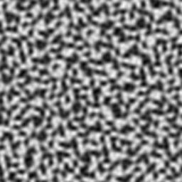

Figure 4.10.1: rblxmath::simplex(rblxmath::vec2(x / 16.f, y / 16.f));

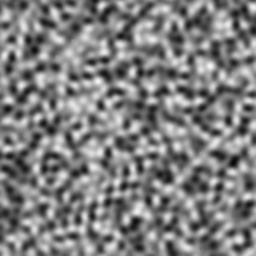

Figure 4.10.2: rblxmath::simplex(rblxmath::vec3(x / 16.f, y / 16.f, 0.5f));

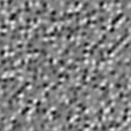

Figure 4.10.3: rblxmath::simplex(rblxmath::vec4(x / 16.f, y / 16.f, 0.5f, 0.5f));

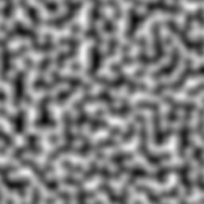

Figure 4.10.4: rblxmath::perlin(rblxmath::vec2(x / 16.f, y / 16.f));

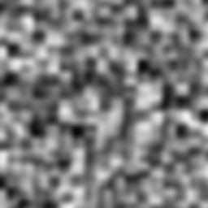

Figure 4.10.5: rblxmath::perlin(rblxmath::vec3(x / 16.f, y / 16.f, 0.5f));

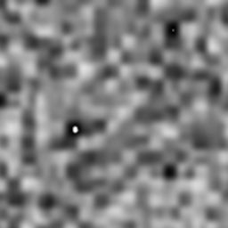

Figure 4.10.6: rblxmath::perlin(rblxmath::vec4(x / 16.f, y / 16.f, 0.5f, 0.5f)));

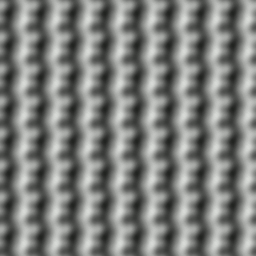

Figure 4.10.7: rblxmath::perlin(rblxmath::vec2(x / 16.f, y / 16.f), rblxmath::vec2(2.0f));

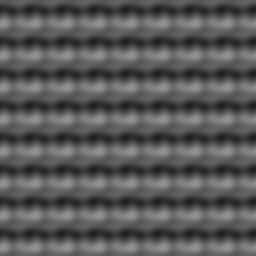

Figure 4.10.8: rblxmath::perlin(rblxmath::vec3(x / 16.f, y / 16.f, 0.5f), rblxmath::vec3(2.0f));


Figure 4.10.9: rblxmath::perlin(rblxmath::vec4(x / 16.f, y / 16.f, rblxmath::vec2(0.5f)), rblxmath::vec4(2.0f));

### <a name="section4_11"></a> 4.11. RBLXMATH\_GTC\_packing

Convert scalar and vector types to and from packed formats, saving space at the cost of precision. However, packing a value into a format that it was previously unpacked from is guaranteed to be lossless.

`<rblxmath/gtc/packing.hpp>` need to be included to use these features.

### <a name="section4_12"></a> 4.12. RBLXMATH\_GTC\_quaternion

Quaternions and operations upon thereof.

`<rblxmath/gtc/quaternion.hpp>` need to be included to use these features.

### <a name="section4_13"></a> 4.13. RBLXMATH\_GTC\_random

Probability distributions in up to four dimensions.

`<rblxmath/gtc/random.hpp>` need to be included to use these features.

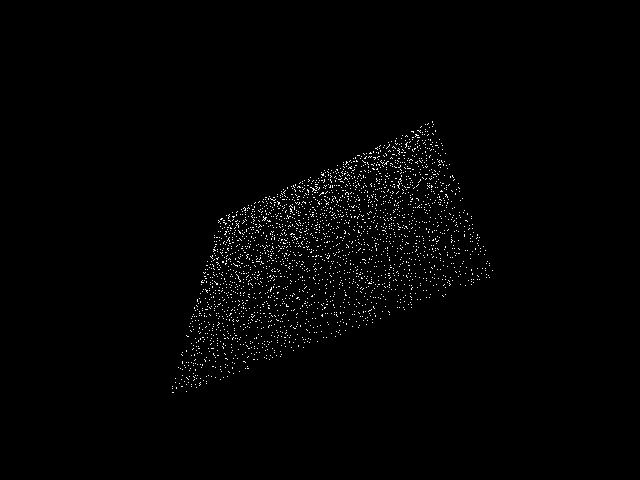

Figure 4.13.1: rblxmath::vec4(rblxmath::linearRand(rblxmath::vec2(-1), rblxmath::vec2(1)), 0, 1);

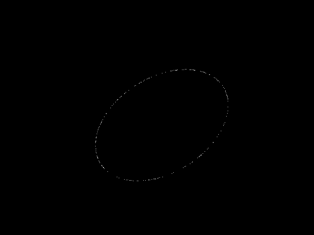

Figure 4.13.2: rblxmath::vec4(rblxmath::circularRand(1.0f), 0, 1);

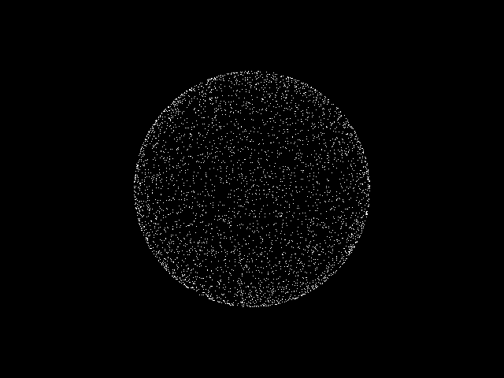

Figure 4.13.3: rblxmath::vec4(rblxmath::sphericalRand(1.0f), 1);

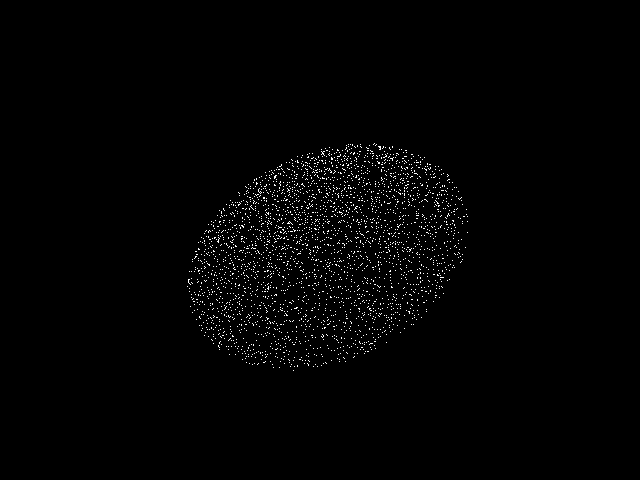

Figure 4.13.4: rblxmath::vec4(rblxmath::diskRand(1.0f), 0, 1);

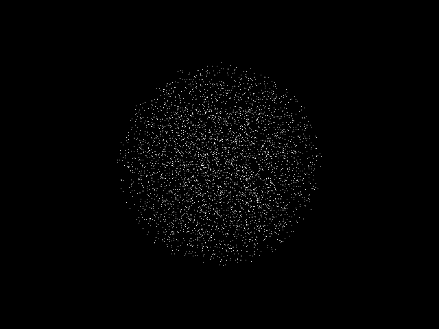

Figure 4.13.5: rblxmath::vec4(rblxmath::ballRand(1.0f), 1);

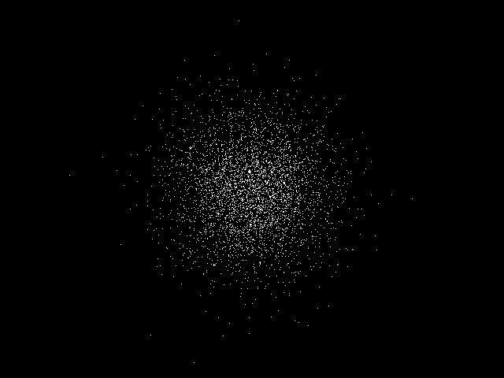

Figure 4.13.6: rblxmath::vec4(rblxmath::gaussRand(rblxmath::vec3(0), rblxmath::vec3(1)), 1);

### <a name="section4_14"></a> 4.14. RBLXMATH\_GTC\_reciprocal

Reciprocal trigonometric functions (e.g. secant, cosecant, tangent).

`<rblxmath/gtc/reciprocal.hpp>` need to be included to use the features of this extension.

### <a name="section4_15"></a> 4.15. RBLXMATH\_GTC\_round

Various rounding operations and common special cases thereof.

`<rblxmath/gtc/round.hpp>` need to be included to use the features of this extension.

### <a name="section4_16"></a> 4.16. RBLXMATH\_GTC\_type\_aligned

Aligned vector types.

`<rblxmath/gtc/type_aligned.hpp>` need to be included to use the features of this extension.

### <a name="section4_17"></a> 4.17. RBLXMATH\_GTC\_type\_precision

Vector and matrix types with defined precisions, e.g. `i8vec4`, which is a 4D vector of signed 8-bit integers.

`<rblxmath/gtc/type\_precision.hpp>` need to be included to use the features of this extension.

### <a name="section4_18"></a> 4.18. RBLXMATH\_GTC\_type\_ptr

Facilitate interactions between pointers to basic types (e.g. `float*`) and RBLXMATH types (e.g. `mat4`).

This extension defines an overloaded function, `rblxmath::value_ptr`, which returns a pointer to the memory layout of any RBLXMATH vector or matrix (`vec3`, `mat4`, etc.). Matrix types store their values in column-major order. This is useful for uploading data to matrices or for copying data to buffer objects.

```cpp
// RBLXMATH_GTC_type_ptr provides a safe solution:
#include <rblxmath/rblxmath.hpp>
#include <rblxmath/gtc/type_ptr.hpp>

void foo()
{
    rblxmath::vec4 v(0.0f);
    rblxmath::mat4 m(1.0f);
    ...
    glVertex3fv(rblxmath::value_ptr(v))
    glLoadMatrixfv(rblxmath::value_ptr(m));
}

// Another solution, this one inspired by the STL:
#include <rblxmath/rblxmath.hpp>

void foo()
{
    rblxmath::vec4 v(0.0f);
    rblxmath::mat4 m(1.0f);
    ...
    glVertex3fv(&v[0]);
    glLoadMatrixfv(&m[0][0]);
}
```

*Note: It would be possible to implement [`glVertex3fv`](http://www.opengl.org/sdk/docs/man2/xhtml/glVertex.xml)(rblxmath::vec3(0)) in C++ with the appropriate cast operator that would result as an
implicit cast in this example. However cast operators may produce programs running with unexpected behaviours without build error or any form of notification.*

`<rblxmath/gtc/type_ptr.hpp>` need to be included to use these features.

### <a name="section4_19"></a> 4.19. RBLXMATH\_GTC\_ulp

Measure a function's accuracy given a reference implementation of it. This extension works on floating-point data and provides results in [ULP](http://ljk.imag.fr/membres/Carine.Lucas/TPScilab/JMMuller/ulp-toms.pdf).

`<rblxmath/gtc/ulp.hpp>` need to be included to use these features.

### <a name="section4_20"></a> 4.20. RBLXMATH\_GTC\_vec1

Add \*vec1 types.

`<rblxmath/gtc/vec1.hpp>` need to be included to use these features.

---
<div style="page-break-after: always;"> </div>

## <a name="section5"></a> 5. OpenGL interoperability

### <a name="section5_1"></a> 5.1. RBLXMATH replacements for deprecated OpenGL functions

OpenGL 3.1 specification has deprecated some features that have been removed from OpenGL 3.2 core profile specification. RBLXMATH provides some replacement functions.

[***glRotate{f, d}:***](https://www.opengl.org/sdk/docs/man2/xhtml/glRotate.xml)

```cpp
rblxmath::mat4 rblxmath::rotate(rblxmath::mat4 const& m, float angle, rblxmath::vec3 const& axis);
rblxmath::dmat4 rblxmath::rotate(rblxmath::dmat4 const& m, double angle, rblxmath::dvec3 const& axis);
```

From `RBLXMATH_GTC_matrix_transform` extension: &lt;rblxmath/gtc/matrix\_transform.hpp&gt;

[***glScale{f, d}:***](http://www.opengl.org/sdk/docs/man2/xhtml/glScale.xml)

```cpp
rblxmath::mat4 rblxmath::scale(rblxmath::mat4 const& m, rblxmath::vec3 const& factors);
rblxmath::dmat4 rblxmath::scale(rblxmath::dmat4 const& m, rblxmath::dvec3 const& factors);
```

From `RBLXMATH_GTC_matrix_transform` extension: &lt;rblxmath/gtc/matrix\_transform.hpp&gt;

[***glTranslate{f, d}:***](https://www.opengl.org/sdk/docs/man2/xhtml/glTranslate.xml)

```cpp
rblxmath::mat4 rblxmath::translate(rblxmath::mat4 const& m, rblxmath::vec3 const& translation);
rblxmath::dmat4 rblxmath::translate(rblxmath::dmat4 const& m, rblxmath::dvec3 const& translation);
```

From `RBLXMATH_GTC_matrix_transform` extension: &lt;rblxmath/gtc/matrix\_transform.hpp&gt;

[***glLoadIdentity:***](https://www.opengl.org/sdk/docs/man2/xhtml/glLoadIdentity.xml)

```cpp
rblxmath::mat4(1.0) or rblxmath::mat4();
rblxmath::dmat4(1.0) or rblxmath::dmat4();
```

From RBLXMATH core library: `<rblxmath/rblxmath.hpp>`

[***glMultMatrix{f, d}:***](https://www.opengl.org/sdk/docs/man2/xhtml/glMultMatrix.xml)

```cpp
rblxmath::mat4() * rblxmath::mat4();
rblxmath::dmat4() * rblxmath::dmat4();
```

From RBLXMATH core library: `<rblxmath/rblxmath.hpp>`

[***glLoadTransposeMatrix{f, d}:***](https://www.opengl.org/sdk/docs/man2/xhtml/glLoadTransposeMatrix.xml)

```cpp
rblxmath::transpose(rblxmath::mat4());
rblxmath::transpose(rblxmath::dmat4());
```

From RBLXMATH core library: `<rblxmath/rblxmath.hpp>`

[***glMultTransposeMatrix{f, d}:***](https://www.opengl.org/sdk/docs/man2/xhtml/glMultTransposeMatrix.xml)

```cpp
rblxmath::mat4() * rblxmath::transpose(rblxmath::mat4());
rblxmath::dmat4() * rblxmath::transpose(rblxmath::dmat4());
```

From RBLXMATH core library: `<rblxmath/rblxmath.hpp>`

[***glFrustum:***](http://www.opengl.org/sdk/docs/man2/xhtml/glFrustum.xml)

```cpp
rblxmath::mat4 rblxmath::frustum(float left, float right, float bottom, float top, float zNear, float zFar);
rblxmath::dmat4 rblxmath::frustum(double left, double right, double bottom, double top, double zNear, double zFar);
```

From `RBLXMATH_GTC_matrix_transform` extension: `<rblxmath/gtc/matrix_transform.hpp>`

[***glOrtho:***](https://www.opengl.org/sdk/docs/man2/xhtml/glOrtho.xml)

```cpp
rblxmath::mat4 rblxmath::ortho(float left, float right, float bottom, float top, float zNear, float zFar);
rblxmath::dmat4 rblxmath::ortho(double left, double right, double bottom, double top, double zNear, double zFar);
```

From `RBLXMATH_GTC_matrix_transform` extension: `<rblxmath/gtc/matrix_transform.hpp>`

### <a name="section5_2"></a> 5.2. RBLXMATH replacements for GLU functions

[***gluLookAt:***](https://www.opengl.org/sdk/docs/man2/xhtml/gluLookAt.xml)

```cpp
rblxmath::mat4 rblxmath::lookAt(rblxmath::vec3 const& eye, rblxmath::vec3 const& center, rblxmath::vec3 const& up);
rblxmath::dmat4 rblxmath::lookAt(rblxmath::dvec3 const& eye, rblxmath::dvec3 const& center, rblxmath::dvec3 const& up);
```

From `RBLXMATH_GTC_matrix_transform` extension: `<rblxmath/gtc/matrix_transform.hpp>`

[***gluOrtho2D:***](https://www.opengl.org/sdk/docs/man2/xhtml/gluOrtho2D.xml)

```cpp
rblxmath::mat4 rblxmath::ortho(float left, float right, float bottom, float top);
rblxmath::dmat4 rblxmath::ortho(double left, double right, double bottom, double top);
```

From `RBLXMATH_GTC_matrix_transform` extension: `<rblxmath/gtc/matrix_transform.hpp>`

[***gluPerspective:***](https://www.opengl.org/sdk/docs/man2/xhtml/gluPerspective.xml)

```cpp
rblxmath::mat4 perspective(float fovy, float aspect, float zNear, float zFar);
rblxmath::dmat4 perspective(double fovy, double aspect, double zNear, double zFar);
```

Note that in RBLXMATH, fovy is expressed in radians, not degrees.

From `RBLXMATH_GTC_matrix_transform` extension: `<rblxmath/gtc/matrix_transform.hpp>`

[***gluPickMatrix:***](https://www.opengl.org/sdk/docs/man2/xhtml/gluPickMatrix.xml)

```cpp
rblxmath::mat4 pickMatrix(rblxmath::vec2 const& center, rblxmath::vec2 const& delta, rblxmath::ivec4 const& viewport);
rblxmath::dmat4 pickMatrix(rblxmath::dvec2 const& center, rblxmath::dvec2 const& delta, rblxmath::ivec4 const& viewport);
```

From `RBLXMATH_GTC_matrix_transform` extension: `<rblxmath/gtc/matrix_transform.hpp>`

[***gluProject:***](http://www.opengl.org/sdk/docs/man2/xhtml/gluProject.xml)

```cpp
rblxmath::vec3 project(rblxmath::vec3 const& obj, rblxmath::mat4 const& model, rblxmath::mat4 const& proj, rblxmath::ivec4 const& viewport);
rblxmath::dvec3 project(rblxmath::dvec3 const& obj, rblxmath::dmat4 const& model, rblxmath::dmat4 const& proj, rblxmath::ivec4 const& viewport);
```

From `RBLXMATH_GTC_matrix_transform` extension: `<rblxmath/gtc/matrix_transform.hpp>`

[***gluUnProject:***](https://www.opengl.org/sdk/docs/man2/xhtml/gluUnProject.xml)

```cpp
rblxmath::vec3 unProject(rblxmath::vec3 const& win, rblxmath::mat4 const& model, rblxmath::mat4 const& proj, rblxmath::ivec4 const& viewport);
rblxmath::dvec3 unProject(rblxmath::dvec3 const& win, rblxmath::dmat4 const& model, rblxmath::dmat4 const& proj, rblxmath::ivec4 const& viewport);
```

From `RBLXMATH_GTC_matrix_transform` extension: `<rblxmath/gtc/matrix_transform.hpp>`

---
<div style="page-break-after: always;"> </div>

## <a name="section6"></a> 6. Known issues

This section reports GLSL features that RBLXMATH can't accurately emulate due to language restrictions.

### <a name="section6_1"></a> 6.1. not function

The GLSL function 'not' is a keyword in C++. To prevent name collisions and ensure a consistent API, the name `not\_` (note the underscore) is used instead.

### <a name="section6_2"></a> 6.2. Precision qualifiers support

RBLXMATH supports GLSL precision qualifiers through prefixes instead of qualifiers. For example, RBLXMATH exposes \verb|lowp_vec4|, \verb|mediump_vec4| and \verb|highp_vec4| as variations of \verb|vec4|.

Similarly to GLSL, RBLXMATH precision qualifiers are used to trade precision of operations in term of [ULPs](http://en.wikipedia.org/wiki/Unit_in_the_last_place) for better performance. By default, all the types use high precision.

```cpp
// Using precision qualifier in GLSL:

ivec3 foo(in vec4 v)
{
    highp vec4 a = v;
    mediump vec4 b = a;
    lowp ivec3 c = ivec3(b);
    return c;
}

// Using precision qualifier in RBLXMATH:

#include <rblxmath/rblxmath.hpp>

ivec3 foo(const vec4 & v)
{
    highp_vec4 a = v;
    medium_vec4 b = a;
    lowp_ivec3 c = rblxmath::ivec3(b);
    return c;
}
```

---
<div style="page-break-after: always;"> </div>

## <a name="section7"></a> 7. FAQ

### <a name="section7_1"></a> 7.1 Why RBLXMATH follows GLSL specification and conventions?

Following GLSL conventions is a really strict policy of RBLXMATH. It has been designed following the idea that everyone does its own math library with his own conventions. The idea is that brilliant developers (the OpenGL ARB) worked together and agreed to make GLSL. Following GLSL conventions
is a way to find consensus. Moreover, basically when a developer knows GLSL, he knows RBLXMATH.

### <a name="section7_2"></a> 7.2. Does RBLXMATH run GLSL program?

No, RBLXMATH is a C++ implementation of a subset of GLSL.

### <a name="section7_3"></a> 7.3. Does a GLSL compiler build RBLXMATH codes?

No, this is not what RBLXMATH attends to do.

### <a name="section7_4"></a> 7.4. Should I use ‘GTX’ extensions?

GTX extensions are qualified to be experimental extensions. In RBLXMATH this means that these extensions might change from version to version without any restriction. In practice, it doesn’t really change except time to
time. GTC extensions are stabled, tested and perfectly reliable in time. Many GTX extensions extend GTC extensions and provide a way to explore features and implementations and APIs and then are promoted to GTC
extensions. This is fairly the way OpenGL features are developed; through extensions.

Stating with RBLXMATH 0.9.9, to use experimental extensions, an application must define RBLXMATH_ENABLE_EXPERIMENTAL.

### <a name="section7_5"></a> 7.5. Where can I ask my questions?

A good place is [stackoverflow](http://stackoverflow.com/search?q=RBLXMATH) using the RBLXMATH tag.

### <a name="section7_6"></a> 7.6. Where can I find the documentation of extensions?

The Doxygen generated documentation includes a complete list of all extensions available. Explore this [*API documentation*](http://rblxmath.g-truc.net/html/index.html) to get a complete
view of all RBLXMATH capabilities!

### <a name="section7_7"></a> 7.7. Should I use ‘using namespace rblxmath;’?

NO! Chances are that if using namespace rblxmath; is called, especially in a header file, name collisions will happen as RBLXMATH is based on GLSL which uses common tokens for types and functions. Avoiding using namespace
rblxmath; will a higher compatibility with third party library and SDKs.

### <a name="section7_8"></a> 7.8. Is RBLXMATH fast?

RBLXMATH is mainly designed to be convenient and that's why it is written against the GLSL specification.

Following the Pareto principle where 20% of the code consumes 80% of the execution time, RBLXMATH operates perfectly on the 80% of the code that consumes 20% of the performances. Furthermore, thanks to the lowp,
mediump and highp qualifiers, RBLXMATH provides approximations which trade precision for performance. Finally, RBLXMATH can automatically produce SIMD optimized code for functions of its implementation.

However, on performance critical code paths, we should expect that dedicated algorithms should be written to reach peak performance.

### <a name="section7_9"></a> 7.9. When I build with Visual C++ with /W4 warning level, I have warnings...

You should not have any warnings even in `/W4` mode. However, if you expect such level for your code, then you should ask for the same level to the compiler by at least disabling the Visual C++ language extensions
(`/Za`) which generates warnings when used. If these extensions are enabled, then RBLXMATH will take advantage of them and the compiler will generate warnings.

### <a name="section7_10"></a> 7.10. Why some RBLXMATH functions can crash because of division by zero?

RBLXMATH functions crashing is the result of a domain error. Such behavior follows the precedent set by C and C++'s standard library. For example, it’s a domain error to pass a null vector (all zeroes) to rblxmath::normalize function, or to pass a negative number into std::sqrt.

### <a name="section7_11"></a> 7.11. What unit for angles is used in RBLXMATH?

GLSL is using radians but GLU is using degrees to express angles. This has caused RBLXMATH to use inconsistent units for angles. Starting with RBLXMATH 0.9.6, all RBLXMATH functions are using radians. For more information, follow
the [link](http://www.g-truc.net/post-0693.html#menu).

### <a name="section7_12"></a> 7.12. Windows headers cause build errors...

Some Windows headers define min and max as macros which may cause compatibility with third party libraries such as RBLXMATH.
It is highly recommended to [`define NOMINMAX`](http://stackoverflow.com/questions/4913922/possible-problems-with-nominmax-on-visual-c) before including Windows headers to workaround this issue.
To workaround the incompatibility with these macros, RBLXMATH will systematically undef these macros if they are defined.

### <a name="section7_13"></a> 7.13. Constant expressions support

RBLXMATH has some C++ [constant expressions](http://en.cppreference.com/w/cpp/language/constexpr) support. However, RBLXMATH automatically detects the use of SIMD instruction sets through compiler arguments to populate its implementation with SIMD intrinsics.
Unfortunately, GCC and Clang doesn't support SIMD instrinsics as constant expressions. To allow constant expressions on all vectors and matrices types, define `RBLXMATH_FORCE_PURE` before including RBLXMATH headers.

---
<div style="page-break-after: always;"> </div>

## <a name="section8"></a> 8. Code samples

This series of samples only shows various RBLXMATH features without consideration of any sort.

### <a name="section8_1"></a> 8.1. Compute a triangle normal

```cpp
#include <rblxmath/rblxmath.hpp> // vec3 normalize cross

rblxmath::vec3 computeNormal(rblxmath::vec3 const& a, rblxmath::vec3 const& b, rblxmath::vec3 const& c)
{
    return rblxmath::normalize(rblxmath::cross(c - a, b - a));
}

// A much faster but less accurate alternative:
#include <rblxmath/rblxmath.hpp> // vec3 cross
#include <rblxmath/gtx/fast_square_root.hpp> // fastNormalize

rblxmath::vec3 computeNormal(rblxmath::vec3 const& a, rblxmath::vec3 const& b, rblxmath::vec3 const& c)
{
    return rblxmath::fastNormalize(rblxmath::cross(c - a, b - a));
}
```

### <a name="section8_2"></a> 8.2. Matrix transform

```cpp
#include <rblxmath/rblxmath.hpp> // vec3, vec4, ivec4, mat4
#include <rblxmath/gtc/matrix_transform.hpp> // translate, rotate, scale, perspective
#include <rblxmath/gtc/type_ptr.hpp> // value_ptr

void setUniformMVP(GLuint Location, rblxmath::vec3 const& Translate, rblxmath::vec3 const& Rotate)
{
    rblxmath::mat4 Projection = rblxmath::perspective(45.0f, 4.0f / 3.0f, 0.1f, 100.f);
    rblxmath::mat4 ViewTranslate = rblxmath::translate(
        rblxmath::mat4(1.0f), Translate);
    rblxmath::mat4 ViewRotateX = rblxmath::rotate(
        ViewTranslate, Rotate.y, rblxmath::vec3(-1.0f, 0.0f, 0.0f));
    rblxmath::mat4 View = rblxmath::rotate(ViewRotateX,
        Rotate.x, rblxmath::vec3(0.0f, 1.0f, 0.0f));
    rblxmath::mat4 Model = rblxmath::scale(
        rblxmath::mat4(1.0f), rblxmath::vec3(0.5f));
    rblxmath::mat4 MVP = Projection * View * Model;
    glUniformMatrix4fv(Location, 1, GL_FALSE, rblxmath::value_ptr(MVP));
}
```

### <a name="section8_3"></a> 8.3. Vector types

```cpp
#include <rblxmath/rblxmath.hpp> // vec2
#include <rblxmath/gtc/type_precision.hpp> // hvec2, i8vec2, i32vec2

std::size_t const VertexCount = 4;

// Float quad geometry
std::size_t const PositionSizeF32 = VertexCount * sizeof(rblxmath::vec2);
rblxmath::vec2 const PositionDataF32[VertexCount] =
{
    rblxmath::vec2(-1.0f,-1.0f),
    rblxmath::vec2( 1.0f,-1.0f),
    rblxmath::vec2( 1.0f, 1.0f),
    rblxmath::vec2(-1.0f, 1.0f)
};

// Half-float quad geometry
std::size_t const PositionSizeF16 = VertexCount * sizeof(rblxmath::hvec2);
rblxmath::hvec2 const PositionDataF16[VertexCount] =
{
    rblxmath::hvec2(-1.0f, -1.0f),
    rblxmath::hvec2( 1.0f, -1.0f),
    rblxmath::hvec2( 1.0f, 1.0f),
    rblxmath::hvec2(-1.0f, 1.0f)
};

// 8 bits signed integer quad geometry
std::size_t const PositionSizeI8 = VertexCount * sizeof(rblxmath::i8vec2);
rblxmath::i8vec2 const PositionDataI8[VertexCount] =
{
    rblxmath::i8vec2(-1,-1),
    rblxmath::i8vec2( 1,-1),
    rblxmath::i8vec2( 1, 1),
    rblxmath::i8vec2(-1, 1)
};

// 32 bits signed integer quad geometry
std::size_t const PositionSizeI32 = VertexCount * sizeof(rblxmath::i32vec2);
rblxmath::i32vec2 const PositionDataI32[VertexCount] =
{
    rblxmath::i32vec2(-1,-1),
    rblxmath::i32vec2( 1,-1),
    rblxmath::i32vec2( 1, 1),
    rblxmath::i32vec2(-1, 1)
};
```

### <a name="section8_4"></a> 8.4. Lighting

```cpp
#include <rblxmath/rblxmath.hpp> // vec3 normalize reflect dot pow
#include <rblxmath/gtc/random.hpp> // ballRand

// vecRand3, generate a random and equiprobable normalized vec3
rblxmath::vec3 lighting(intersection const& Intersection, material const& Material, light const& Light, rblxmath::vec3 const& View)
{
    rblxmath::vec3 Color = rblxmath::vec3(0.0f);
    rblxmath::vec3 LightVertor = rblxmath::normalize(
        Light.position() - Intersection.globalPosition() +
        rblxmath::ballRand(0.0f, Light.inaccuracy());

    if(!shadow(Intersection.globalPosition(), Light.position(), LightVertor))
    {
        float Diffuse = rblxmath::dot(Intersection.normal(), LightVector);
        if(Diffuse &lt;= 0.0f)
            return Color;

        if(Material.isDiffuse())
            Color += Light.color() * Material.diffuse() * Diffuse;

        if(Material.isSpecular())
        {
            rblxmath::vec3 Reflect = rblxmath::reflect(-LightVector, Intersection.normal());
            float Dot = rblxmath::dot(Reflect, View);
            float Base = Dot &gt; 0.0f ? Dot : 0.0f;
            float Specular = rblxmath::pow(Base, Material.exponent());
            Color += Material.specular() \* Specular;
        }
    }

    return Color;
}
```

---
<div style="page-break-after: always;"> </div>

## <a name="section9"></a> 9. Contributing to RBLXMATH

### <a name="section9_1"></a> 9.1. Submitting bug reports

Bug should be reported on Github using the [issue page](https://github.com/g-truc/rblxmath/issues).

A minimal code to reproduce the issue will help.

Additional, bugs can be configuration specific. We can report the configuration by defining `RBLXMATH_FORCE_MESSAGES` before including RBLXMATH headers then build and copy paste the build messages RBLXMATH will output.

```cpp
#define RBLXMATH_FORCE_MESSAGES
#include <rblxmath/rblxmath.hpp>
```

An example of build messages generated by RBLXMATH:

```plaintext
RBLXMATH: 0.9.9.1
RBLXMATH: C++ 17 with extensions
RBLXMATH: GCC compiler detected"
RBLXMATH: x86 64 bits with AVX instruction set build target
RBLXMATH: Linux platform detected
RBLXMATH: RBLXMATH_FORCE_SWIZZLE is undefined. swizzling functions or operators are disabled.
RBLXMATH: RBLXMATH_FORCE_SIZE_T_LENGTH is undefined. .length() returns a rblxmath::length_t, a typedef of int following GLSL.
RBLXMATH: RBLXMATH_FORCE_UNRESTRICTED_GENTYPE is undefined. Follows strictly GLSL on valid function genTypes.
RBLXMATH: RBLXMATH_FORCE_DEPTH_ZERO_TO_ONE is undefined. Using negative one to one depth clip space.
RBLXMATH: RBLXMATH_FORCE_LEFT_HANDED is undefined. Using right handed coordinate system.
```

### <a name="section9_2"></a> 9.2. Contributing to RBLXMATH with pull request

This tutorial will show us how to successfully contribute a bug-fix to RBLXMATH using GitHub's Pull Request workflow.

We will be typing git commands in the Terminal. Mac and Linux users may have git pre-installed. You can download git from [here](http://git-scm.com/downloads).

The tutorial assumes you have some basic understanding of git concepts - repositories, branches, commits, etc. Explaining it all from scratch is beyond the scope of this tutorial. Some good links to learn git basics are: [Link 1](http://git-scm.com/book/en/Getting-Started-Git-Basics), [Link 2](https://www.atlassian.com/git/tutorial/git-basics)

#### Step 1: Setup our RBLXMATH Fork

We will make our changes in our own copy of the RBLXMATH sitory. On the RBLXMATH GitHub repo and we press the Fork button.
We need to download a copy of our fork to our local machine. In the terminal, type:

```plaintext
>>> git clone <our-repository-fork-git-url>
```

This will clone our fork repository into the current folder.

We can find our repository git url on the Github reposotory page. The url looks like this: `https://github.com/<our-username>/<repository-name>.git`

#### Step 2: Synchronizing our fork

We can use the following command to add `upstream` (original project repository) as a remote repository so that we can fetch the latest RBLXMATH commits into our branch and keep our forked copy is synchronized.

```plaintext
>>> git remote add upstream https://github.com/processing/processing.git
```

To synchronize our fork to the latest commit in the RBLXMATH repository, we can use the following command:

```plaintext
>>> git fetch upstream
```

Then, we can merge the remote master branch to our current branch:

```plaintext
>>> git merge upstream/master
```

Now our local copy of our fork has been synchronized. However, the fork's copy is not updated on GitHub's servers yet. To do that, use:

```plaintext
>>> git push origin master
```

#### Step 3: Modifying our RBLXMATH Fork

Our fork is now setup and we are ready to modify RBLXMATH to fix a bug.

It's a good practice to make changes in our fork in a separate branch than the master branch because we can submit only one pull request per branch.

Before creating a new branch, it's best to synchronize our fork and then create a new branch from the latest master branch.

If we are not on the master branch, we should switch to it using:

```plaintext
>>> git checkout master
```

To create a new branch called `bugifx`, we use:

```plaintext
git branch bugfix
```

Once the code changes for the fix is done, we need to commit the changes:

```plaintext
>>> git commit -m "Resolve the issue that caused problem with a specific fix #432"
```

The commit message should be as specific as possible and finished by the bug number in the [RBLXMATH GitHub issue page](https://github.com/g-truc/rblxmath/issues)

Finally, we need to push our changes in our branch to our GitHub fork using:

```plaintext
>>> git push origin bugfix
```

Some things to keep in mind for a pull request:

* Keep it minimal: Try to make the minimum required changes to fix the issue. If we have added any debugging code, we should remove it.
* A fix at a time: The pull request should deal with one issue at a time only, unless two issue are so interlinked they must be fixed together.
* Write a test: RBLXMATH is largely unit tests. Unit tests are in `rblxmath/test` directory. We should also add tests for the fixes we provide to ensure future regression doesn't happen.
* No whitespace changes: Avoid unnecessary formatting or whitespace changes in other parts of the code. Be careful with auto-format options in the code editor which can cause wide scale formatting changes.
* Follow [RBLXMATH Code Style](#section9_3) for consistency.
* Tests passes: Make sure RBLXMATH build and tests don't fail because of the changes.

#### Step 4: Submitting a Pull Request

We need to submit a pull request from the `bugfix` branch to RBLXMATH's master branch.

On the fork github page, we can click on the *Pull Request* button. Then we can describe our pull request. Finally we press *Send Pull Request*.

Please be patient and give them some time to go through it.

The pull request review may suggest additional changes. So we can make those changes in our branch, and push those changes to our fork repository. Our pull request will always include the latest changes in our branch on GitHub, so we don't need to resubmit the pull request.

Once your changes have been accepted, a project maintainer will merge our pull request.

We are grateful to the users for their time and effort in contributing fixes.

### <a name="section9_3"></a> 9.3. Coding style

#### Indentation

Always tabs. Never spaces.

#### Spacing

No space after if. Use if(blah) not if (blah). Example if/else block:

```cpp
if(blah)
{
    // yes like this
}
else
{
    // something besides
}
```

Single line if blocks:

```cpp
if(blah)
    // yes like this
else
    // something besides
```

No spaces inside parens:

```cpp
if (blah)    // No
if( blah )   // No
if ( blah )  // No
if(blah)     // Yes
```

Use spaces before/after commas:

```cpp
someFunction(apple,bear,cat);     // No
someFunction(apple, bear, cat);   // Yes
```

Use spaces before/after use of `+, -, *, /, %, >>, <<, |, &, ^, ||, &&` operators:

```cpp
vec4 v = a + b;
```

#### Blank lines

One blank line after the function blocks.

#### Comments

Always one space after the // in single line comments

One space before // at the end of a line (that has code as well)

Try to use // comments inside functions, to make it easier to remove a whole block via /\* \*/

#### Cases

```cpp
#define RBLXMATH_MY_DEFINE 76

class myClass
{};

myClass const MyClass;

namespace rblxmath{ // rblxmath namespace is for public code
namespace detail // rblxmath::detail namespace is for implementation detail
{
    float myFunction(vec2 const& V)
    {
        return V.x + V.y;
    }

    float myFunction(vec2 const* const V)
    {
        return V->x + V->y;
    }
}//namespace detail
}//namespace rblxmath
```

---
<div style="page-break-after: always;"> </div>

## <a name="section10"></a> 10. References

### <a name="section10_1"></a> 10.1. OpenGL specifications

* OpenGL 4.3 core specification
* [GLSL 4.30 specification](http://www.opengl.org/registry/doc/GLSLangSpec.4.30.7.diff.pdf)
{width="2.859722222222222in" height="1.6083333333333334in"}- [*GLU 1.3 specification*](http://www.opengl.org/documentation/specs/glu/glu1_3.pdf)

### <a name="section10_2"></a> 10.2. External links

* [RBLXMATH on stackoverflow](http://stackoverflow.com/search?q=RBLXMATH)

### <a name="section10_3"></a> 10.3. Projects using RBLXMATH

***[Leo’s Fortune](http://www.leosfortune.com/)***

Leo’s Fortune is a platform adventure game where you hunt down the cunning and mysterious thief that stole your gold. Available on PS4, Xbox One, PC, Mac, iOS and Android.

Beautifully hand-crafted levels bring the story of Leo to life in this epic adventure.

“I just returned home to find all my gold has been stolen! For some devious purpose, the thief has dropped pieces of my gold like breadcrumbs through the woods.”

“Despite this pickle of a trap, I am left with no choice but to follow the trail.”

“Whatever lies ahead, I must recover my fortune.” -Leopold


[***OpenGL 4.0 Shading Language Cookbook***](http://www.packtpub.com/opengl-4-0-shading-language-cookbook/book?tag=rk/opengl4-abr1/0811)

A set of recipes that demonstrates a wide of techniques for producing high-quality, real-time 3D graphics with GLSL 4.0, such as:

* Using GLSL 4.0 to implement lighting and shading techniques.
* Using the new features of GLSL 4.0 including tessellation and geometry shaders.
* Using textures in GLSL as part of a wide variety of techniques from basic texture mapping to deferred shading.

Simple, easy-to-follow examples with GLSL source code are provided, as well as a basic description of the theory behind each technique.

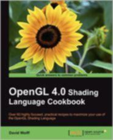

[***Outerra***](http://outerra.com/)

A 3D planetary engine for seamless planet rendering from space down to the surface. Can use arbitrary resolution of elevation data, refining it to centimetre resolution using fractal algorithms.


[***Falcor***](https://github.com/NVIDIA/Falcor)

Real-time rendering research framework by NVIDIA.

[***Cinder***](https://libcinder.org/)

Cinder is a free and open source library for professional-quality creative coding in C++.

Cinder is a C++ library for programming with aesthetic intent - the sort of development often called creative coding. This includes domains like graphics, audio, video, and computational geometry. Cinder is cross-platform, with official support for OS X, Windows, iOS, and WinRT.

Cinder is production-proven, powerful enough to be the primary tool for professionals, but still suitable for learning and experimentation. Cinder is released under the [2-Clause BSD License](http://opensource.org/licenses/BSD-2-Clause).


[***opencloth***](https://github.com/mmmovania/opencloth/)

A collection of source codes implementing cloth simulation algorithms in OpenGL.

Simple, easy-to-follow examples with GLSL source code, as well as a basic description of the theory behind each technique.

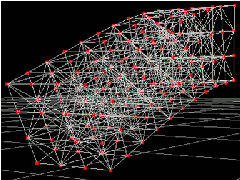

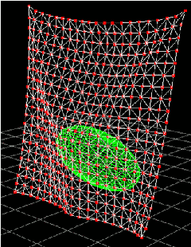

[***LibreOffice***](https://www.libreoffice.org/)

LibreOffice includes several applications that make it the most powerful Free and Open Source office suite on the market.

[***Are you using RBLXMATH in a project?***](mailto:rblxmath@g-truc.net)

### <a name="section10_4"></a> 10.4. Tutorials using RBLXMATH

* [Sascha Willems' Vulkan examples](https://github.com/SaschaWillems/Vulkan), Examples and demos for the new Vulkan API
* [VKTS](https://github.com/McNopper/Vulkan) Vulkan examples using VulKan ToolS (VKTS)
* [*The OpenGL Samples Pack*](http://www.g-truc.net/project-0026.html#menu), samples that show how to set up all the different new features
* [*Learning Modern 3D Graphics programming*](http://www.arcsynthesis.org/gltut/), a great OpenGL tutorial using RBLXMATH by Jason L. McKesson
* [*Morten Nobel-Jørgensen’s*](http://blog.nobel-joergensen.com/2011/04/02/rblxmath-brilliant-math-library-for-opengl/) review and use an [*OpenGL renderer*](https://github.com/mortennobel/RenderE)
* [*Swiftless’ OpenGL tutorial*](http://www.swiftless.com/opengltuts.html) using RBLXMATH by Donald Urquhart
* [*Rastergrid*](http://rastergrid.com/blog/), many technical articles with companion programs using RBLXMATH by Daniel Rákos\
* [*OpenGL Tutorial*](http://www.opengl-tutorial.org), tutorials for OpenGL 3.1 and later
* [*OpenGL Programming on Wikibooks*](http://en.wikibooks.org/wiki/OpenGL_Programming): For beginners who are discovering OpenGL.
* [*3D Game Engine Programming*](http://3dgep.com/): Learning the latest 3D Game Engine Programming techniques.
* [Game Tutorials](http://www.gametutorials.com/opengl-4-matrices-and-rblxmath/), graphics and game programming.
* [open.gl](https://open.gl/), OpenGL tutorial
* [c-jump](http://www.c-jump.com/bcc/common/Talk3/Math/RBLXMATH/RBLXMATH.html), RBLXMATH tutorial
* [Learn OpenGL](http://learnopengl.com/), OpenGL tutorial
* [***Are you using RBLXMATH in a tutorial?***](mailto:rblxmath@g-truc.net)

### <a name="section10_5"></a> 10.5. Equivalent for other languages

* [*cglm*](https://github.com/recp/cglm): OpenGL Mathematics (rblxmath) for C.
* [*GlmSharp*](https://github.com/Philip-Trettner/GlmSharp): Open-source semi-generated RBLXMATH-flavored math library for .NET/C\#.
* [rblxmath-js](https://github.com/humbletim/rblxmath-js): JavaScript adaptation of the OpenGL Mathematics (RBLXMATH) C++ library interfaces
* [JVM OpenGL Mathematics (RBLXMATH)](https://github.com/kotlin-graphics/rblxmath): written in Kotlin, Java compatible
* [JGLM](https://github.com/jroyalty/jglm) - Java OpenGL Mathematics Library
* [SwiftGL Math Library](https://github.com/SwiftGL/Math/blob/master/Sources/rblxmath.swift) RBLXMATH for Swift
* [rblxmath-go](https://github.com/jbowtie/rblxmath-go): Simple linear algebra library similar in spirit to RBLXMATH
* [openll](https://github.com/Polkm/openll): Lua bindings for OpenGL, RBLXMATH, RBLXWIN, OpenAL, SOIL and PhysicsFS
* [rblxmath-rs](https://github.com/dche/rblxmath-rs): GLSL mathematics for Rust programming language
* [rblxmathpython](https://github.com/Queatz/rblxmathpython): RBLXMATH math library for Python

### <a name="section10_6"></a> 10.6. Alternatives to RBLXMATH

* [*CML*](http://cmldev.net/): The CML (Configurable Math Library) is a free C++ math library for games and graphics.
* [*Eigen*](http://eigen.tuxfamily.org/): A more heavy weight math library for general linear algebra in C++.
* [*glhlib*](http://glhlib.sourceforge.net/): A much more than glu C library.
* Are you using or developing an alternative library to RBLXMATH?

### <a name="section10_7"></a> 10.7. Acknowledgements

RBLXMATH is developed and maintained by [*Christophe Riccio*](http://www.g-truc.net) but many contributors have made this project what it is.

Special thanks to:

* Ashima Arts and Stefan Gustavson for their work on [*webgl-noise*](https://github.com/ashima/webgl-noise) which has been used for RBLXMATH noises implementation.
* [*Arthur Winters*](http://athile.net/library/wiki/index.php?title=Athile_Technologies) for the C++11 and Visual C++ swizzle operators implementation and tests.
* Joshua Smith and Christoph Schied for the discussions and the experiments around the swizzle operators implementation issues.
* Guillaume Chevallereau for providing and maintaining the [*nightlight build system*](http://my.cdash.org/index.php?project=RBLXMATH).
* Ghenadii Ursachi for RBLXMATH\_GTX\_matrix\_interpolation implementation.
* Mathieu Roumillac for providing some implementation ideas.
* [*Grant James*](http://www.zeuscmd.com/) for the implementation of all combination of none-squared matrix products.
* Jesse Talavera-Greenberg for his work on the manual amount other things.
* All the RBLXMATH users that have report bugs and hence help RBLXMATH to become a great library!
